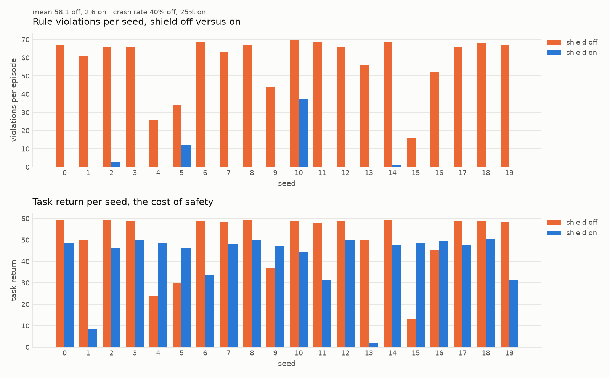
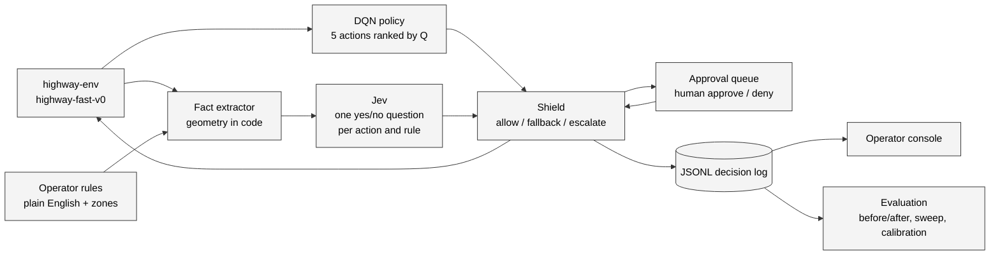
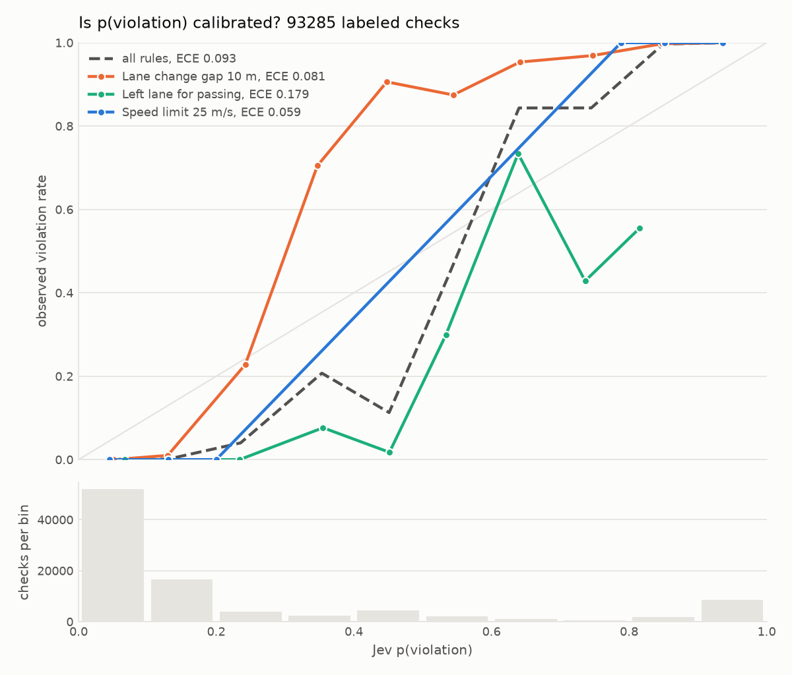
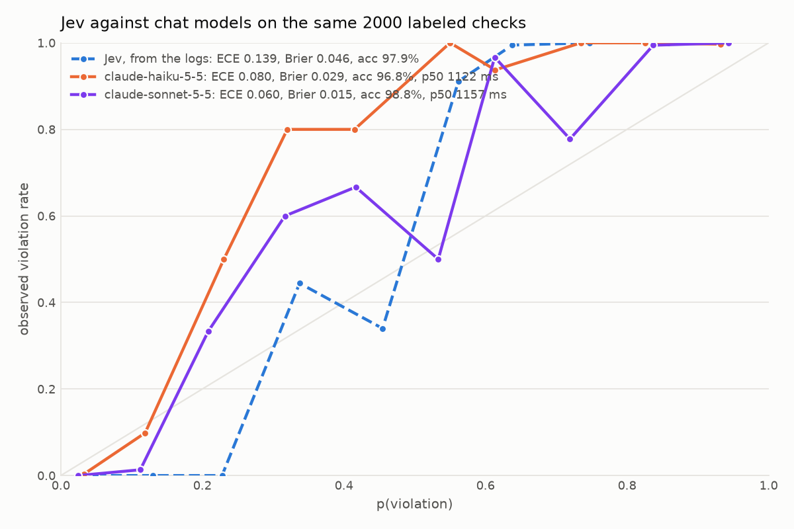

# Interlock

**The policy was trained once. The rules changed live, in plain English.**

Interlock is a runtime safety shield for a reinforcement learning agent, with a
human on the loop. A Stable-Baselines3 DQN drives in [highway-env](https://highway-env.farama.org/)
on task reward alone and knows nothing about rules. At every step,
[Jev](https://docs.typesafe.ai), TypeSafe's decision model, judges each of the
agent's candidate actions against operator rules typed in plain English and
returns a probability of violation. Code then allows the action, falls back to
the agent's next-best safe action, or pauses and asks a human. An operator
console shows the road, the rules, the approval queue, a decision inspector and
the evaluation numbers.

Built as a demo of runtime safety for learned policies and human-on-the-loop
design.

Full documentation, with a user guide for the console and the command line and
a developer guide for every module and contract, is at
[sequenzia.github.io/interlock](https://sequenzia.github.io/interlock/). It builds
from `docs/` with `uv run mkdocs serve -a 127.0.0.1:8080`.

Interlock is an independent personal project and is not affiliated with any
company. The name is the safety-engineering term for a mechanism that permits
an action only when a condition holds, with a supervised override.



## What it shows

- **A reward-only policy made safe at runtime, with no retraining.** The DQN
  only ever sees env reward (speed, no collisions, a small right-lane bonus).
  Rules such as "Speed limit 25 m/s" or "Lane 3 is closed ahead for a work zone"
  are added while it drives.
- **A system that knows when to ask a person.** Jev's probability drives three
  outcomes: confident safe runs, confident violation falls back, and the
  uncertain band escalates to an approval queue with the facts, the rule and the
  probability.
- **Honest numbers.** Violations, task return, crashes, escalation rate,
  latency, cost and calibration, measured over seeded episodes with the shield
  off and on, and a threshold sweep that shows the tradeoff.

## How it works



Each simulation step:

1. The DQN ranks all five actions (LANE_LEFT, IDLE, LANE_RIGHT, FASTER, SLOWER) by Q-value.
2. The fact extractor turns the simulator state plus each candidate action into
   structured facts with units: ego speed and lane, the lane after the action,
   gaps and closing speeds to neighbouring vehicles, and any closed zones ahead.
   All geometry happens in code. Jev never counts, compares numbers or reasons
   in multiple hops, which its documentation lists as weaknesses.
3. One Jev request per candidate asks, for every enabled rule, whether
   executing that action would violate it. Each answer is a probability.
4. Code drops any candidate that would close on the vehicle ahead in under
   2 seconds. That physics floor is set at launch and no rule can type it
   away. The shield then takes the top remaining action's worst probability
   across rules and applies two thresholds, by default 0.3 and 0.7:
   - below the allow threshold: execute it;
   - above the block threshold, with a lower-ranked action that is confidently
     safe: execute that one;
   - otherwise: pause the simulation and ask the operator. Approve runs the
     proposal, deny runs the fallback, and when no candidate is confidently
     safe the queue lists all five so the operator can pick one.
5. Ground-truth checkers label every candidate against every rule for scoring.
   They never influence the decision.
6. One JSONL record per step holds the facts, Q-values, every probability, the
   decision, the human's answer and the raw Jev exchange. The console, replay
   and evaluation all read this one record format.

If Jev is unreachable and the question is not in the cache, the shield never
invents a judgment. It escalates at p = 0.5 and tells the operator the judge is
unavailable.

## Results

20 seeded episodes of 60 steps with seven standing rules (speed limit, lane
change gap, left lane for passing, 2 second headway, one lane change per 10
seconds, and two fuzzy rules about moving in ahead of a faster vehicle and
driving conservatively in dense traffic), live Jev, and a simulated operator
that answers from the ground-truth checkers. The full run takes about seven
minutes and costs under a dollar.

| Configuration | Violations per episode | Task return | Crash rate | Steps escalated |
| --- | --- | --- | --- | --- |
| Shield off | 105.45 | 50.7 | 40% | 0.0% |
| Shield on, 0.2 / 0.8 | 3.45 | 45.7 | 0% | 48.2% |
| Shield on, 0.3 / 0.7 (default) | 3.55 | 46.0 | 0% | 16.5% |

By rule, shield off to on: speed limit 1030 violations to 0, lane change gap
124 to 1, left lane for passing 8 to 0, headway 647 to 65, lane-change rate
300 to 5. When no candidate satisfies every rule the shield asks the operator
to choose rather than running a last resort, and a 2 second time-to-collision
floor in code removes the closest calls before any rule is judged, which is
why no shielded episode crashes. Calibration over 174,625 labeled checks gives an expected
calibration error of 0.095 and 98.7% accuracy at a 0.5 cut, with the speed and
lane-change rate rules at 100% and the passing rule the weakest. Jev answers a full step of five
requests in about 158 ms at the median from a cold cache.



The same questions put to chat models on 2,000 checks balanced over rule and
label: Claude Sonnet 5.5 is better calibrated than Jev on that sample, ECE
0.060 against 0.139, yet at the default band it would have allowed 3
violations and blocked 5 compliant actions where Jev allowed and blocked
none, because Jev errs toward uncertainty and the band turns that into a
question for the operator. Jev's price is operator load, 20.6% of checks
escalated against 3.1%; the chat model's price is about a second per check
against 158 ms per step, and roughly 860 times the cost per episode.



The threshold sweep, the reading of these numbers and the design decisions
behind them live in `internal/build-plan.md`. Measured Jev behavior from the
Day 1 spike is in `internal/jev-spike-results.md`.

## The operator console

A dark, dense console in React with a Canvas 2D road view.

- **Road view**: ego-centered, four lanes, vehicles interpolated between steps,
  closed zones hatched, the executed action as a solid arrow and a blocked
  action as a ghost arrow.
- **Operator rules**: type any rule, or add one of the eight presets. Toggle,
  remove, drop a work zone ahead with one click. The zone arms its rule and
  retires it once the zone is passed.
- **Approval queue**: the proposed action, its facts in plain sentences, the
  rule that fired, the probability, what deny would execute, and approve or
  deny by button or keyboard.
- **Decision timeline and inspector**: one tick per step colored by outcome.
  Click a tick to scrub the road view to that step and open the inspector: the
  five candidates by Q-value, the probability grid against every rule with the
  checker's label, the facts, and the exact Jev request and response.
- **Shield toggle on the same seed**, speed control, replay of any logged run,
  and a metrics tab with the before/after bars, the tradeoff curve and the
  reliability diagram.

Keyboard: space plays and pauses, `n` steps, `a` and `d` answer an escalation,
arrow keys scrub, Esc returns to live.

## Getting started

Requirements: Python 3.12 via [uv](https://docs.astral.sh/uv/), Node 20+ with
[pnpm](https://pnpm.io/), and a TypeSafe API key for live judging. Everything
also runs offline in mock mode, which replays cached Jev answers and escalates
anything it has not seen.

```
uv sync --all-groups
cp backend/.env.example backend/.env        # add TYPESAFE_API_KEY
uv run pytest                               # backend tests
```

`uv sync` also installs the `interlock` command. Every subcommand is a thin
wrapper over a module in `backend/`, so `uv run python -m backend.run_episode`
and friends still work and take the same flags.

Train the agent once. Checkpoints are not committed. The 100k-step run takes
about 25 minutes on a laptop and is promoted to `models/dqn_highway.zip`:

```
uv run interlock train --timesteps 100000 --promote
```

Run a shielded episode headlessly, with per-step output and a JSONL log:

```
uv run interlock run --shield on
uv run interlock run --shield off --seed 3
uv run interlock run --jev mock --zone-at-step 10
```

Run the console. One command starts the WebSocket server on :8000 and the Vite
dev server on http://127.0.0.1:5173, and Ctrl-C stops both:

```
cd frontend && pnpm install && cd ..                           # once
uv run interlock console                                       # live Jev when the key is present
uv run interlock console --jev mock --escalation-timeout 0     # offline, wait for the operator
uv run interlock console --reload --open                       # dev loop, open the browser
```

The console flags map onto the server's environment variables: `--jev` sets
`JEV_MODE` (default: live when the key is present), `--escalation-timeout`
sets `ESCALATION_TIMEOUT_S` (default 20; 0 waits for the operator
indefinitely, recommended for a live demo), and `--seed`, `--model-path` and
`--cache` set `SEED`, `MODEL_PATH` and `JEV_CACHE_PATH`. The two halves still
run on their own with `uv run uvicorn backend.server:app --reload` and
`cd frontend && pnpm dev`, or `uv run interlock console --no-ui` for the
server alone.

Evaluate and plot:

```
uv run interlock eval --seeds 0-19 --all --concurrency 2   # off, five threshold pairs, report
uv run interlock eval --report                             # rebuild internal/eval and internal/plots
```

Frontend checks:

```
cd frontend && pnpm typecheck && pnpm build
cd frontend && pnpm test:e2e           # Playwright smoke test on its own mock backend
```

Documentation site:

```
uv run mkdocs serve -a 127.0.0.1:8080  # live preview; port 8000 belongs to the backend
uv run mkdocs build --strict           # the GitHub Pages workflow runs this
```

## Deploying for a live demo

The console is a static Vite build and deploys to Vercel as is. The server is
one stateful process: the simulator, the loaded DQN and the open escalation
live in memory, and the sim loop runs between messages. That rules out
serverless hosting for the backend, Vercel included, where instances are
stateless, scale to zero when idle and close WebSockets at the function's max
duration. So the backend runs as one always-on container on any host that
takes a Dockerfile, and the console points at it.

Build and check the backend image locally first:

```
docker build --platform linux/amd64 -t interlock-backend .
docker run --rm -p 8000:8000 --env-file backend/.env -e ESCALATION_TIMEOUT_S=0 interlock-backend
curl http://127.0.0.1:8000/health
```

The image carries the lock, `backend/`, `models/dqn_highway.zip`, the eval
report for the metrics tab and the warm Jev cache when
`backend/logs/jev_cache.jsonl` exists, so demo seeds answer from cache.
`backend/.env` never enters the image. The container reads the same variables
from its environment: `TYPESAFE_API_KEY`, `JEV_MODE`, `ESCALATION_TIMEOUT_S`,
`SEED`, plus two for hosting:

- `CONSOLE_ORIGINS`: comma-separated console origins allowed to fetch
  `/health` and `/eval/latest` cross-origin, for example
  `https://interlock-demo.vercel.app`. Unset keeps the server same-origin only,
  which is what the Vite proxy needs locally.
- `PORT`: listen port, default 8000. Hosts that inject their own port work as is.

Linux resolves the CPU-only torch wheel through `[tool.uv.sources]` in
`pyproject.toml`, so the image skips the CUDA libraries.

The backend host is Fly.io. `fly.toml` at the repo root describes one
always-on `shared-cpu-2x` machine with auto-stop off, so the in-memory session
survives idle minutes. `fly deploy` builds the Dockerfile remotely from this
directory, so the gitignored checkpoint and cache ship without a commit:

```
brew install flyctl && fly auth login                          # once
fly apps create interlock-backend                              # once; another name if taken, then update fly.toml
grep '^TYPESAFE_API_KEY=' backend/.env | fly secrets import    # the key stays out of the shell history
fly deploy --ha=false                                          # one machine: the session is one process
curl https://interlock-backend.fly.dev/health
```

Deploy the console from `frontend/` with the Vercel CLI once the backend has a
public https URL:

```
cd frontend
vercel link --project interlock-console       # once; the project root is frontend/
vercel env add VITE_BACKEND_URL production    # https://<backend host>, no trailing slash
vercel --prod
```

`VITE_BACKEND_URL` is read at build time by `src/backend-url.ts`: fetches go
to that origin and the socket to the same host as `wss`. Unset, which is the
local and e2e case, everything stays on the page's own origin behind the Vite
proxy. Then add the Vercel production aliases to `CONSOLE_ORIGINS` under `[env]` in
`fly.toml` and run `fly deploy` again. The live console is
https://interlock-demo.vercel.app and the backend is https://interlock-backend.fly.dev.

One session per backend, by design: every browser on the console URL sees the
same episode, and any of them can press play, reset or approve. Share the URL
with the room only if that is the demo you want.

## Repository layout

```
backend/
  env.py           highway-fast-v0 with the demo configuration
  train.py         DQN training and checkpoint evaluation
  policy.py        ranked actions with Q-values
  facts.py         simulator state to structured facts and sentences
  constraints.py   rule store, presets, zone lifecycle
  jev_client.py    Jev through typesafe-sdk, content cache, mock mode
  shield.py        allow / fallback / escalate rules
  checkers.py      ground-truth checkers, scoring only
  logger.py        the JSONL record
  episode.py       the per-step loop shared by the CLI and the server
  cli.py           the interlock command: run, eval, train, spike, label, autolabel, baseline, console
  run_episode.py   headless episode, behind interlock run
  server.py        FastAPI WebSocket server, live and replay
  metrics.py       episode metrics, aggregates, calibration
  evaluate.py      batch evaluation and report
  label.py         hand-label fuzzy rules for calibration, behind interlock label
  autolabel.py     the fixed standard for the fuzzy rules, behind interlock autolabel
  plots.py         slide plots
  spike/           the Day 1 Jev spike
frontend/          Vite, React, TypeScript, Tailwind, Zustand, Recharts, Playwright
docs/              documentation site source (MkDocs Material), published to GitHub Pages
internal/          project brief, build plan, spike results, evaluation report, plots
models/            trained checkpoints (gitignored)
tests/             pytest suite
```

## Design decisions worth knowing

- **Geometry stays in code.** Jev receives precomputed JSON with units in the
  field names and judges; it never calculates.
- **Positive, literal questions.** Each question asserts that the action would
  violate one rule, quoted verbatim. The spike showed that rules phrased with
  negation score softer; the console suggests a positive rephrase but keeps the
  operator's text.
- **Rules and zones share a lifecycle.** Jev weights a rule that asserts a
  closure even when no zone is in the facts, so dropping a zone arms its rule
  and passing the last zone retires it.
- **Fuzzy rules escalate by design.** "Keep the left lane for passing only"
  sits near 0.5 for Jev regardless of phrasing. That is the human-on-the-loop
  moment, not a bug to prompt away.
- **The shield enforces rules, not collision safety.** An unattended
  default-deny can override the policy's own crash avoidance, which argues for
  a following-distance rule in the rule set and for no auto-deny in a live demo.
