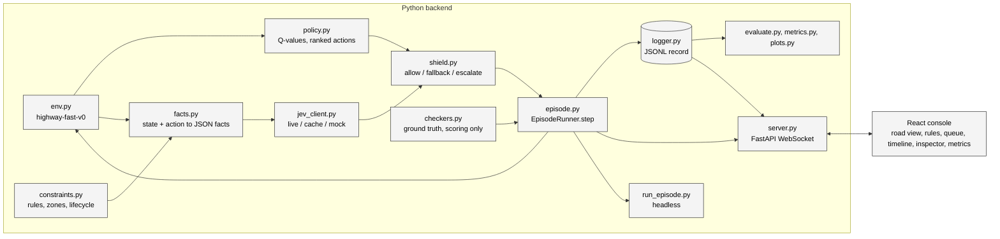
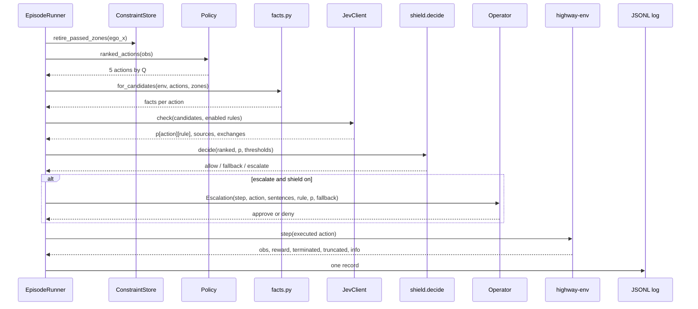

# Architecture

Interlock is one Python process that owns a simulator, a trained policy and a
judge, and a static React console that renders what the process streams. This
page explains the pieces, how a step flows through them, which contracts tie
them together and how the processes are arranged in development and in
production.

## Components



| Component | Module | Responsibility |
| --- | --- | --- |
| Environment | `backend/env.py` | `highway-fast-v0` with four lanes, 60 steps, 30 vehicles, one decision per second. The reward is the highway-env default and never mentions a rule. |
| Policy | `backend/policy.py`, `backend/train.py` | A Stable-Baselines3 DQN trained on task reward alone. Exposes a Q-value per action so the whole ranking is available every step. |
| Fact extractor | `backend/facts.py` | Turns the simulator state plus one candidate action into JSON facts with units in the field names, and the same facts as plain sentences for people. All geometry happens here. |
| Constraint store | `backend/constraints.py` | Operator rules as plain-English strings, optional checker ids, work zones, and the lifecycle that ties the lane-closed rule to its zone. |
| Judge | `backend/jev_client.py` | One Jev request per candidate action with one yes/no question per enabled rule. A content-addressed cache in front, a mock mode that serves only the cache, and an explicit "unavailable" answer when there is no judge. |
| Shield | `backend/shield.py` | Pure functions over the ranked actions and the probability grid. Two thresholds produce allow, fallback or escalate, and the shield only acts alone with a confidently safe action. |
| Checkers | `backend/checkers.py` | Closed-form ground truth per (candidate, rule) for scoring and calibration. Never consulted by the shield. |
| Episode loop | `backend/episode.py` | `EpisodeRunner.step()`, the one place the loop above runs. Takes an operator callback for escalations. |
| Log | `backend/logger.py` | One JSONL record per step. The contract between backend, console and evaluation. |
| Server | `backend/server.py` | FastAPI app with a single WebSocket. One session per process, live and replay sources, pause on escalation. |
| Headless CLI | `backend/cli.py`, `backend/run_episode.py` | The `interlock` command: `run`, `eval`, `train`, `spike`, `console`. |
| Evaluation | `backend/evaluate.py`, `backend/metrics.py`, `backend/plots.py` | Seeded batch runs with the shield off and on, a threshold sweep, calibration, a JSON report and PNG plots. |
| Console | `frontend/src/` | Vite, React 19, TypeScript strict, Tailwind, one Zustand store, Canvas 2D road view, Recharts for the metrics tab. |

## One loop, three front doors

`EpisodeRunner.step()` is the only code path that proposes, judges, decides and
executes. Everything else wraps it with a different operator and a different
transport:

| Entry point | Operator for escalations | Transport | Purpose |
| --- | --- | --- | --- |
| `interlock run` (`backend/run_episode.py`) | `simulated`, `approve` or `deny` from `backend/episode.py` | stdout, one line per step | Headless episodes, debugging, warming the cache |
| `interlock console` (`backend/server.py`) | A future resolved by the UI, or a timeout that denies | WebSocket messages | The operator console |
| `interlock eval` (`backend/evaluate.py`) | `simulated_operator`, which answers from the checkers | per-seed JSONL and `metrics.json` | Before/after numbers, the sweep, calibration |

Shield off is the same path with the decision overwritten to allow: facts, Jev
and checkers still run in shadow. That is why the before/after comparison and
the calibration data come from identical code on identical seeds. The
[per-step loop page](backend/episode-loop.md) has the details.

## A step, end to end



The checkers label every candidate against every enabled rule in the same step,
but the labels go only into the record. `shield.decide()` receives the
probability grid and nothing else.

## The contracts

Three documents are the fixed points that let the parts evolve independently.

| Contract | Produced by | Consumed by | Page |
| --- | --- | --- | --- |
| The JSONL log record | `backend/logger.py` via `EpisodeRunner` | Console (live and replay), inspector, `metrics.py`, `evaluate.py`, `server.replay_metrics` | [Log record](contracts/log-record.md) |
| The WebSocket protocol | `backend/server.py` | `frontend/src/ws-client.ts` and the store | [WebSocket protocol](contracts/websocket-protocol.md) |
| The evaluation report | `backend/evaluate.py` | The metrics tab through `/eval/latest`, the plots | [Evaluation report](contracts/eval-report.md) |

`frontend/src/types.ts` mirrors the first two in TypeScript. A change to the
record goes to the contract page first, then `backend/logger.py`, then
`types.ts`.

## Process topology

=== "Local development"

    `uv run interlock console` starts two child processes: uvicorn on port
    8000 and the Vite dev server on port 5173. Vite proxies `/ws`, `/health`
    and `/eval` to the server, so the browser talks to one origin. Flags on
    the console subcommand become environment variables for the server.

    ```mermaid
    flowchart LR
      B[Browser :5173] <--> V[Vite dev server<br/>proxy /ws /health /eval]
      V <--> U[uvicorn backend.server:app :8000]
      U --> J[Jev API<br/>or the cache in mock mode]
      classDef default fill:#f4f4f4,stroke:#333,color:#000;
    ```

=== "Production"

    The console is a static Vite build on Vercel. `VITE_BACKEND_URL` is baked
    in at build time, so fetches go to the backend origin and the socket opens
    as `wss` on the same host. The backend is one always-on container on
    Fly.io built from the root `Dockerfile`. `CONSOLE_ORIGINS` enables CORS
    for the two HTTP routes; the WebSocket upgrade needs none.

    ```mermaid
    flowchart LR
      B[Browser] --> V[Vercel<br/>static console]
      B <--> F[Fly.io container<br/>uvicorn, one session]
      F --> J[Jev API]
      classDef default fill:#f4f4f4,stroke:#333,color:#000;
    ```

The backend cannot be serverless. The session is one stateful process: the
simulator, the loaded DQN, the open escalation and the step history live in
memory, and the play loop advances between messages. The
[deployment internals page](deployment-internals.md) covers the image, the Fly
configuration and the Vercel build.

## Design decisions that shape the code

These are the invariants the code enforces and the reasons recorded in the
module docstrings and the README.

- **Geometry stays in code.** Jev's documented weak spots are arithmetic,
  counting, numeric comparison, negation and multi-hop reasoning. `facts.py`
  computes gaps, closing speeds, lane numbers and zone entry; Jev receives
  precomputed JSON and judges.
- **Positive, literal questions.** Every question asserts that executing the
  candidate would violate one rule, with the rule text quoted verbatim. The
  console suggests a positive rephrase for rules typed as "No ... if ..." but
  never changes the operator's text.
- **Checkers score only.** `checkers.py` is imported by `episode.py` for
  labels and by nothing on the decision path. The simulated operator used in
  evaluation reads those labels, which is a property of the evaluation, not of
  the shield.
- **Never fake a judgment.** A cache miss with no judge, or a live failure
  after the SDK's retries, yields p = 0.5 marked `unavailable`. The shield
  escalates and the operator sees "judge unavailable".
- **Rules and zones share a lifecycle.** Dropping a zone adds or re-enables
  the lane-closed rule; passing the last zone disables it, because a rule that
  asserts a closure keeps biasing the judge even when no zone is in the facts.
- **One record format for everything.** Live streaming, replay, the inspector
  and the evaluation read the same JSONL line, so a logged run is a complete
  backup of a demo.
- **The headless CLI always works.** The server and the UI sit on top of the
  loop, not beside it.

## Where to go next

- [Per-step loop](backend/episode-loop.md) for `EpisodeRunner` line by line.
- [Shield algorithm](backend/shield.md) for the decision rules and the fallback search.
- [Facts](backend/facts.md) and [Jev integration](backend/jev-integration.md) for what the judge sees and how it is asked.
- [Server and session](backend/server.md) for the WebSocket side.
- [Frontend overview](frontend/overview.md) for the console.
- [Repository layout](repository-layout.md) for a file by file map.
