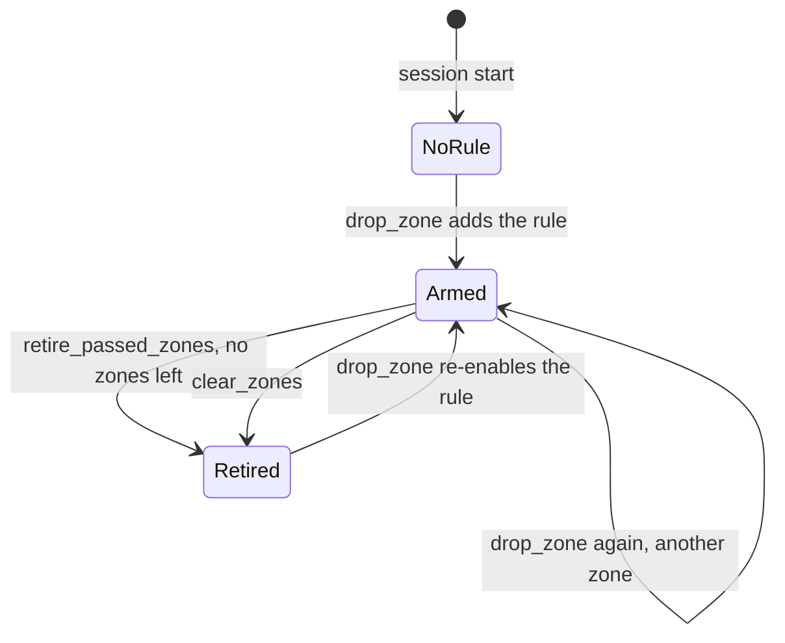

# Constraints and checkers

Two modules share this page because they share the rule texts.
`backend/constraints.py` holds what the operator says: rules as plain
English, optional checker ids, and work zones. `backend/checkers.py` holds
closed-form ground truth for the six crisp preset rules, used for scoring and
for the simulated operator, and never for the shield's decision. Two further
presets are fuzzy by design and have no checker; hand labels score them (see
[Evaluation internals](evaluation.md)).

## Constraints

```python
@dataclass
class Constraint:
    id: str              # "c1", "c2", ... stable for the session
    text: str            # what Jev reads, verbatim
    enabled: bool = True
    checker: str | None = None
```

The eight presets, in the order the console shows the chips. `PRESETS` maps
a preset id to its text; for the first six the id is also the checker id, and
`preset_checker(id)` returns `None` for the two in `FUZZY_PRESETS`.

| Preset id | Checker | Preset text |
| --- | --- | --- |
| `speed_limit` | same | Speed limit 25 m/s |
| `lane_change_gap` | same | No lane change if a vehicle is within 10 m in the target lane |
| `left_lane_passing` | same | Keep the left lane for passing only |
| `lane_closed` | same | Lane 3 is closed ahead for a work zone |
| `headway` | same | Keep at least 2 seconds of headway to the vehicle ahead |
| `lane_change_rate` | same | At most 1 lane change in any 10 seconds |
| `cut_in` | none | Leave plenty of room when moving in ahead of a faster vehicle |
| `dense_traffic` | none | Drive conservatively in dense traffic |

The two fuzzy presets were added on Oct 17 (plan section 16.2) to give the
judge rules that a code checker cannot reproduce. They are phrased as
positive statements, like every preset, because the spike showed negation
scores softer.

### Inferring a checker from typed text

`infer_checker(text)` lowercases and collapses whitespace, then:

1. An exact match to a preset returns its checker.
2. `speed limit <digit>` returns `speed_limit`, so "Speed limit 20 m/s" is scored.
3. `lane change` together with `within <number> m` returns `lane_change_gap`.
4. `passing only` returns `left_lane_passing`.
5. `lane <digit> is closed` returns `lane_closed`.
6. `at least <number> s of headway` returns `headway`.
7. `at most <number> lane change` returns `lane_change_rate`.
8. Anything else returns `None`: a free-text rule that Jev judges and that only
   hand labels can score. A fuzzy preset's exact text also returns `None`.

The checkers parse the number out of the text (`_number` with a regex and a
default), so a typed variant with a different limit or gap is scored against
its own number.

### The store

`ConstraintStore` is one session's mutable set of rules and zones. Ids are
assigned from a counter and never reused within the session.

| Method | Behaviour |
| --- | --- |
| `add(text, checker=None)` | Collapses whitespace, rejects empty text with `ValueError`, infers the checker when none is given, appends and returns the constraint. |
| `add_presets(preset_ids=None)` | Adds the named presets with their checkers, all eight when `None`. The evaluator's standing rules are every preset but `lane_closed`. |
| `enabled()` | The enabled rules, the only ones the judge is asked about. |
| `get`, `toggle(id, enabled)`, `remove(id)` | By id; `KeyError` for an unknown id, which the server turns into an error message. |
| `drop_zone(ego_x_m, lane=3, ahead_m=120, length_m=200, name="work zone")` | Places a zone in absolute road coordinates starting `ahead_m` in front of the ego, then adds the lane-closed rule with text `Lane <lane> is closed ahead for a <name>` or re-enables the existing one. |
| `zone_rule()` | The constraint whose checker is `lane_closed`, if any. |
| `retire_passed_zones(ego_x_m)` | Removes zones whose end is behind the ego; when none remain, disables the lane-closed rule. Returns the retired zones. |
| `clear_zones()` | Drops every zone and disables the rule. |
| `snapshot()` | `{"constraints": [...], "zones": [...]}` as dicts, the shape the `hello` and `constraints` messages carry. |

### The zone lifecycle

```python
@dataclass
class Zone:
    name: str
    lane: int      # 1-based, numbered from the left
    start_m: float # absolute road coordinate
    end_m: float
```

A zone and the lane-closed rule share a lifecycle on purpose. The rule text
asserts a closure, and the judge weights that assertion even when the facts
carry no zone, so a stale rule would keep biasing every action in that lane
after the zone was passed. Dropping a zone arms the rule; passing the last zone
retires it. `EpisodeRunner.step()` calls `retire_passed_zones` before building
facts, and the console shows "Zone passed. The lane-closed rule was retired."
when it sees the rule flip off in the same message that empties the zone list.



!!! note "Zones survive a reset"
    `Session.reset` recreates the episode but keeps the `ConstraintStore`,
    rules and zones included. A zone dropped at 550 m stays at 670 to 870 m
    in absolute coordinates, so a reset episode meets it again. Remove the
    rule or wait for the ego to pass the zone to retire it; there is no
    "clear zones" control in the console.

## Checkers

Each checker is a pure function of one candidate's facts and the constraint,
returning `True` for a violation. They are closed-form on the pre-step state,
so every candidate gets a label every step, which is what makes five labeled
checks per rule per step available for calibration.

| Checker | Violation when |
| --- | --- |
| `check_speed_limit` | `action.target_speed_after_mps` is greater than the limit parsed from the text (default 25). It is the target after the action, not the current speed, so `FASTER` from 25 m/s is a violation and `SLOWER` from 30 m/s is not. |
| `check_lane_change_gap` | The action is `LANE_LEFT` or `LANE_RIGHT`, actually changes lane (not a road-edge no-op), and the smaller of the behind and ahead gaps in the target lane is below the threshold parsed from the text (default 10 m). Absent neighbours do not count. |
| `check_left_lane_passing` | The lane after the action is the leftmost, and there is no slower vehicle within 40 m ahead in the lane to its right (`lane_right_of_lane_after.slower_vehicle_ahead_within_40_m`). |
| `check_lane_closed` | Any zone in the facts has `action_enters_zone` true. |
| `check_headway` | `lane_after_action.headway_s` is below the seconds parsed from the text (default 2). No vehicle ahead means no violation. |
| `check_lane_change_rate` | The action is a real lane change and `history.lane_changes_last_10_steps` plus this one exceeds the count parsed from the text (default 1). The facts send Jev the same sum as `action.lane_changes_last_10_steps_including_this_action`, so the judge and the checker read one number. |

`label(facts, constraint)` returns `None` when the constraint has no checker;
`label_all(candidates, constraints)` builds `{action: {constraint_id: label}}`
for the step.

### Scoring only, enforced by structure

The invariant that checkers never feed the shield is kept by the call graph
rather than by a flag:

- `shield.decide()` takes the ranking, the probability grid and the
  thresholds. There is no parameter through which a label could arrive.
- `episode.py` calls `label_all` and writes the result into the record's
  `checks[].ground_truth` and into `Escalation.ground_truth`.
- The only consumer of `Escalation.ground_truth` is `simulated_operator`,
  which stands in for a human during evaluation and headless runs. The
  server strips the field before sending an escalation to the console.
- `metrics.py` and `evaluate.py` read labels from the records to count
  violations and build the reliability diagram.

So in mock mode, in live mode and in shadow mode alike, the decision depends
on Jev and the thresholds, and on nothing the checkers know.

## Free-text rules

A rule without a checker is judged like any other. Its checks carry
`ground_truth: null`, the inspector shows no mark in its cells, the console
labels it "no checker, not scored", and it contributes no violations. For
calibration, `collect_checks` in `metrics.py` looks the pair up in the hand
labels under `backend/logs/labels/`, keyed by a hash of the candidate's facts
and the rule text; a labeled pair counts under the rule's preset id or a slug
of its text with its labeler as `label_source`, an unlabeled one is skipped.
`interlock label` collects those labels by hand and `interlock autolabel` by
the fixed standard. The escalation's
`ground_truth` ignores free-text rules, which means the simulated operator
denies an uncertain escalation fired only by them (an unknown label is
treated as a violation).

## Tests

`tests/test_constraints.py` covers preset order and inferred checkers, the
fuzzy presets having none, typed variants including headway and lane-change
rate, empty text rejection, ids and toggling, zone drops in absolute
coordinates arming the rule, and retirement when the last zone is passed.
`tests/test_checkers.py` covers the speed rule on the target after the
action, the gap rule only on real lane changes, the passing rule needing
someone slower to the right, the zone entry fact, the headway rule on the
headway after the action, the lane-change rate counting recent changes plus
this one, free text labelling `None`, and `label_all` covering every pair.
`tests/test_label.py` covers the labeling command. `tests/test_episode.py` checks that a
zone dropped mid-episode appears in the facts and retires during the episode.
