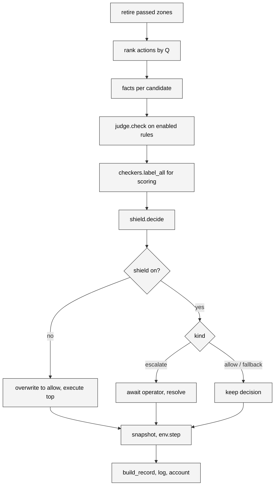

# Per-step loop

`backend/episode.py` holds `EpisodeRunner`, the one place where a step is
proposed, judged, decided, executed and logged. The headless CLI, the WebSocket
server and the evaluation harness all construct an `EpisodeRunner` and call
`step()`; they differ only in the operator they pass for escalations and in
where the output goes. This page walks through the class in the order it runs.

## Construction

```python
EpisodeRunner(
    *,
    policy: Policy,                 # ranked actions with Q-values
    judge: JevClient,               # live, cached or mock
    store: ConstraintStore,         # rules and zones, shared with the caller
    thresholds: Thresholds | None,  # defaults to 0.2 / 0.8
    shield_on: bool = True,
    operator: Operator | None,      # async callback for escalations, default simulated
    operator_name: str = "simulated",  # recorded in human.operator
    logger: JsonlLogger | None,     # None means no file
    env_config: dict | None,        # overrides for make_env
    source: str = "live",           # recorded in every record's source field
)
```

The constructor makes the environment once. `reset(seed)` sets the seed, a new
run id (`<UTC stamp>_seed<N>_<on|off>`), zeroes the step counter and the
running totals, resets the environment and returns the render snapshot. The
`ConstraintStore` belongs to the caller and is not touched by `reset`, which is
how the console keeps its rules across episodes.

!!! note "The server and the CLI set the run id differently"
    `interlock run` computes the run id before constructing the runner so the
    log path and the printed banner agree, then assigns `runner.run_id`
    after `run()` has called `reset()`. The server lets `reset()` mint it and
    opens the JSONL file from it. Both end up under `backend/logs/runs/`.

## `step()` in order

```python
async def step(self) -> StepResult:
```

1. **Retire passed zones.** `store.retire_passed_zones(ego_x_m)` drops any zone
   whose end is behind the ego and, when none remain, disables the lane-closed
   rule. This runs first so the facts and the enabled rule set agree.
2. **Rank the actions.** `policy.ranked_actions(obs)` returns all five actions
   sorted by Q-value, best first; `names` keeps that order.
3. **Build the facts.** The runner reads the ego's lane, derives the
   `history` block from the lanes of past steps with `facts.lane_history`,
   records this step's lane, and `facts.for_candidates(env, names,
   store.zones, history)` makes one facts object per action from the live
   simulator state. See [Facts](facts.md).
4. **Ask the judge.** `judge.check(candidates, store.enabled())` returns a
   `CheckResult` with `p[action][constraint_id]`, per-question sources, the
   exchanges that were actually sent, latency, tokens and cost. Only enabled
   rules are asked. See [Jev integration](jev-integration.md).
5. **Label for scoring.** `checkers.label_all(candidates, enabled)` gives
   `labels[action][constraint_id]` as `True`, `False` or `None`. These never
   reach the decision; they go into the record and into the simulated
   operator's answer.
6. **Decide.** `facts.noop_actions(candidates)` names the actions that would
   change nothing, then `decide(names, check.p, thresholds, noop)` returns a
   `Decision` of kind `allow`, `fallback` or `escalate`, with a reason on
   escalations. See [Shield algorithm](shield.md).
7. **Apply the shield mode.**
    - Shield off: the decision is overwritten to `allow` with the proposed
      action executed, `all_blocked` cleared and the reason dropped.
      Everything above still ran, so the record carries the probabilities,
      labels and would-be fallback the shield would have used. This is
      shadow mode.
    - Shield on and `escalate`: the runner builds an `Escalation`, awaits
      `self.operator(escalation)`, times the wait, records
      `human = {decision, action, latency_ms, operator}` and calls
      `resolve(decision, answer)`. Approve executes the proposed action, deny
      the fallback, override the candidate the operator named.
    - Shield on and any other kind: the decision stands.
8. **Snapshot, then act.** `facts.snapshot(env)` captures the ego and every
   other vehicle before `env.step()`, so the record's positions describe the
   state the decision was made in. `env.step(ACTION_INDEX[executed])` advances
   the simulator one second of sim time.
9. **Write the record.** `build_record(...)` assembles the JSONL line with the
   run metadata, the snapshot, zones, constraints (enabled and disabled),
   every candidate with its facts, sentences and checks, the decision fields,
   the human answer, the judge summary, the reward and the crash flag. If a
   logger is attached the line is written and flushed immediately. See
   [Log record](../contracts/log-record.md).
10. **Account.** `_account()` updates `Totals`: step count, return, crash,
    decision counts, violations of the executed action per rule, human answer
    counts, judge sources, latencies, tokens and cost.
11. **Return** a `StepResult` with the record, the escalation if there was
    one, and the `terminated` and `truncated` flags. `done` is their union:
    the episode ends on a crash or after the configured duration.



## The escalation item

```python
@dataclass(frozen=True)
class Escalation:
    id: str                    # "<run_id>-<step>"
    step: int
    action: str                # the proposed top action
    sentences: list[str]       # the proposed action's facts as sentences
    constraint_id: str | None  # the rule with the highest p on the proposed action
    constraint_text: str | None
    p: float                   # that probability
    q_rank: int                # always 0: the proposal is the top-ranked action
    fallback: str              # what deny would execute
    fallback_kind: str         # safe | least_bad | last_resort
    judge_unavailable: bool    # any answer this step came from no judge
    reason: EscalationReason   # uncertain | no_compliant_action
    candidates: list[dict]     # every ranked action: action, rank, p, constraint_id, noop
    ground_truth: bool | None  # proposed action breaks any enabled rule, per the checkers
    violations_by_action: dict[str, int | None]  # true labels per candidate
```

`ground_truth` is `any()` over the proposed action's labels, or `None` when no
enabled rule has a checker; `violations_by_action` counts true labels per
candidate, `None` when it has none. Both exist for the simulated operator.
The server strips them before sending the item to the console, so a human
never sees the answer key. `candidates` is what the queue lists when the
reason is `no_compliant_action`, and what an override is validated against.

## Operators

An operator is `Callable[[Escalation], Awaitable[Answer]]` where `Answer` has
a `decision` of `"approve"`, `"deny"` or `"override"` and, for an override,
the `action` to run.

| Name | Behaviour | Used by |
| --- | --- | --- |
| `simulated` | Uncertain: deny when `ground_truth` is `True` or `None`, approve when `False`. No compliant action: override with the candidate that breaks the fewest rules, ties to the ranking, approving when that is the proposal; with no labels at all, deny. | `interlock eval`, the default for `interlock run` |
| `approve` | Always approve. | `interlock run --operator approve` |
| `deny` | Always deny. | `interlock run --operator deny` |
| `Session._operator` | Publish the item over the socket and await a future the UI resolves; a timeout denies. | The console |

The `OPERATORS` dict maps the first three names to their functions and is what
`--operator` validates against.

## Totals and the summary

`Totals` is a running accumulator; `summary()` renders it as the dict that
`interlock run` prints at the end and that the server sends as the `metrics`
message during a live episode:

| Field | Meaning |
| --- | --- |
| `run_id`, `seed`, `shield_on`, `judge_mode` | Identity of the run |
| `steps`, `return`, `crashed` | Length, summed reward, whether a crash ended it |
| `decisions` | Count per decision kind |
| `conflicts` | Escalations with reason `no_compliant_action` |
| `violations`, `violations_total` | Executed-action violations per rule id (every rule in the store, zero when none) and their sum |
| `human` | Count per operator answer |
| `judge_sources` | Steps per step-level source: `live`, `cache`, `unavailable` |
| `latency_ms_p50`, `latency_ms_p95` | Over the step wall-clock of every step, including cached ones |
| `input_tokens`, `cost_usd` | Summed from the judge |

`backend/metrics.py` recomputes richer versions of these from the records
alone; the two agree on counts but the eval's latency percentiles cover live
steps only.

## `run()` for headless episodes

```python
async def run(self, seed, max_steps=None, on_step=None, zone_at_step=None) -> dict
```

Resets, then loops over `step()` until the episode is done or `max_steps`
is reached. When `zone_at_step` matches the current step index, it calls
`store.drop_zone(ego_x_m)` before that step, which is how `interlock run
--zone-at-step 10` and the eval's `--zone-at-step` place the default work
zone. `on_step` receives each `StepResult`; `interlock run` uses it to print a
line per step. The return value is `summary()`.

`close()` closes the environment. Callers also close the judge, which owns the
HTTP client.

## Where the three callers differ

| | `run_episode.py` | `server.py` | `evaluate.py` |
| --- | --- | --- | --- |
| Operator | from `--operator` | `Session._operator` | `simulated_operator` |
| Rules | `--rules` presets | whatever the UI added | the three standing presets |
| Logger | `backend/logs/runs/<run_id>.jsonl` or `--log` | `backend/logs/runs/<run_id>.jsonl` per reset | `backend/logs/eval/<stamp>_<label>/seed<N>.jsonl` |
| Pace | as fast as the judge answers | `steps_per_sec` while playing | as fast as the judge answers, `--concurrency` seeds at once |
| Source field | the judge mode | the judge mode | the judge mode |

Read the [server page](server.md) for how the play loop, the escalation future
and replay wrap this class, and the [evaluation internals](evaluation.md) for
the batch side.
