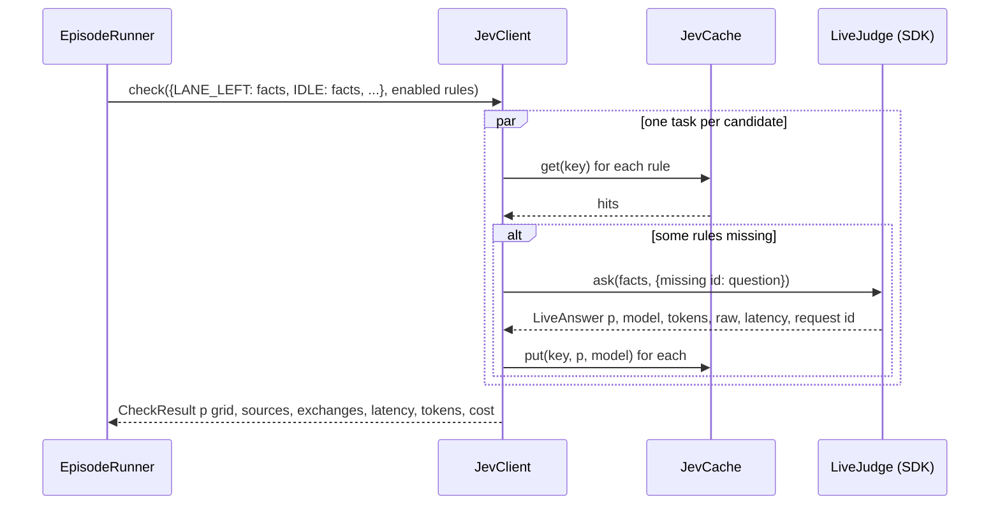

# Jev integration

`backend/jev_client.py` is the only module that talks to Jev. It builds one
question per (candidate action, rule) pair, sends one request per candidate,
caches every answer by content, and degrades to an explicit "unavailable"
answer when there is no judge. This page covers the question, the request
shape, the cache, the client modes and the accounting that ends up in the log.

## What Jev is asked

Jev answers typed questions about a `state` with probabilities. Interlock uses
one question type, `noul`, a yes/no judgment that returns a number from 0 to
1. Each question asserts that executing the candidate action would violate one
rule, with the rule text quoted verbatim:

```python
Noul(
    instructions='Executing the candidate action described in state would violate this operator rule: "Speed limit 25 m/s"',
    criteria={
        "true": "The action, once executed, breaks the rule or puts the ego vehicle in a state the rule forbids.",
        "false": "The action complies with the rule, or the rule does not apply to this situation.",
    },
)
```

`build_question(rule_text, candidate=None)` produces it. The phrasing is a
positive assertion with no negation in the instructions or the criteria, and
the returned `noul` value is used directly as p(violation). The rule text is
the operator's, untouched: the console may suggest a positive rephrase for a
rule typed as "No ... if ...", but the operator decides.

The `candidate` parameter exists for an alternative request shape that puts
every candidate into one state object and names the sub-object in each
question. The shield does not use it; the spike keeps it for comparison.

## Request shape: one request per candidate

`JevClient.check(candidates, constraints)` fires one request per candidate
action with `asyncio.gather`, so a step costs five requests in parallel. Each
request's `state` is that candidate's facts object, flat and about one action,
and its `questions` map is keyed by constraint id with one `noul` per enabled
rule. There is no indirection for the judge to resolve, and the cache can work
per candidate.



## The cache

```python
def cache_key(model, state, question) -> str
```

The key is the SHA-256 of canonical JSON (sorted keys, compact separators) of
the model id, the full state object, the question's instructions and its
criteria. Two steps with identical facts and the same rule text therefore share
an answer, and any change to the facts schema, the question wording, the rule
text or the model starts a fresh cache.

`JevCache` loads `backend/logs/jev_cache.jsonl` into a dict at start and
appends one line per new answer:

```json
{"key": "<sha256>", "p": 0.07, "model": "jev-1.13.0", "ts": 1760656551.2}
```

`JevCache(None)` is an in-memory cache with no file, which the tests use. The
server and the CLI take the path from `JEV_CACHE_PATH` or `--cache`; the
Docker image ships the repository's cache file when it exists so demo seeds
answer from cache.

### Partial hits

Within one candidate, each rule is looked up separately. Only the rules that
missed are sent in the live request, and the response fills in just those.
`sources[action][constraint_id]` records `cache` or `live` per question, and
the step-level `source` in the record is `unavailable` if any question was
unavailable, else `live` if any was live, else `cache`. A step that was
entirely served from cache has no exchange and shows "no request sent" in the
inspector.

## Client modes

```python
make_client(mode: "live" | "mock", cache_path=DEFAULT_CACHE_PATH, model=DEFAULT_MODEL) -> JevClient
```

| Mode | `JevClient.live` | Cache miss | Used when |
| --- | --- | --- | --- |
| `live` | a `LiveJudge` | one request through the SDK | `TYPESAFE_API_KEY` is set and `JEV_MODE` is `auto` or `live` |
| `mock` | `None` | p = 0.5 flagged `unavailable` | no key, `JEV_MODE=mock`, `--jev mock`, the e2e test |

`JevClient.mode` reports `"live"` or `"mock"` and is what the status strip's
"jev live" and "jev mock" badges show.

### LiveJudge

`LiveJudge` wraps `AsyncTypeSafeClient` from `typesafe-sdk` with the pinned
model and a `RetryPolicy` of two retries and a 10 second timeout. The SDK
reads `TYPESAFE_API_KEY` from the environment; `backend/.env` is loaded by the
CLI and the server before the client is built. `ask(state, questions)` returns
a `LiveAnswer` with the probability per question id, the model the API
reported, input tokens, the raw JSON response, the latency and the request id.
When the SDK raises an API, connection or timeout error after its retries,
`ask` returns `None`.

The model is pinned to `DEFAULT_MODEL = "jev-1.13.0"`, the version the API
reported when the project was built. The cache key includes it.

## Never fake a judgment

When `ask` returns `None`, or when there is no live judge at all, every missing
question gets `UNAVAILABLE_P = 0.5` with source `unavailable`, and an
`Exchange` with no response is recorded so the inspector can show that a
request was attempted. A probability of 0.5 sits inside any sensible band, so
the shield escalates, the escalation item carries `judge_unavailable = True`,
and the approval card shows "judge unavailable, p is a placeholder". The
operator answers the question the judge could not. This is the whole offline
story: mock mode with a warm cache replays known answers, and anything new
goes to the human.

## What the client returns

```python
@dataclass
class CheckResult:
    p: dict[str, dict[str, float]]          # action -> constraint id -> p(violation)
    sources: dict[str, dict[str, Source]]   # same shape, "live" | "cache" | "unavailable"
    model: str
    source: Source                          # step summary
    latency_ms: float                       # wall-clock for the whole step
    input_tokens: int
    cost_usd: float
    questions: dict[str, dict]              # constraint id -> the question as sent
    exchanges: list[Exchange]               # one per request actually sent
```

`judge_record()` renders the summary that lands in the log record's `judge`
field: model, source, latency, tokens, cost, the questions shared by every
candidate, and the exchanges. Each `Exchange` has the candidate action, the
constraint ids it asked, the raw response, its own latency, source and request
id. The request body is not stored: it is the candidate's facts plus the
questions for the asked ids, and the inspector rebuilds it from those.

## Cost accounting

Cost is input tokens times `USD_PER_INPUT_TOKEN`, which encodes the published
price of $0.042 per million input tokens at the time the project was built;
output tokens are free. Cached answers cost nothing and add no tokens. The
status strip's cost figure is the running sum from `Totals`; the eval reports
cost per episode. A full 20 seed run of every configuration came to under a
dollar.

## Tuning knobs

| Constant | Value | Effect |
| --- | --- | --- |
| `DEFAULT_MODEL` | `jev-1.13.0` | Request model and part of the cache key. `--model` on `interlock run` overrides it. |
| `UNAVAILABLE_P` | 0.5 | The placeholder probability when there is no judge. |
| `DEFAULT_CACHE_PATH` | `backend/logs/jev_cache.jsonl` | Overridden by `JEV_CACHE_PATH` or `--cache`. |
| `LiveJudge(timeout_s=10.0)` and `RetryPolicy(max_retries=2)` | | How long a step can stall before the shield escalates instead. |
| `--concurrency` on `interlock eval` | 3 | Episodes in flight, each firing five requests per step, to stay under the API rate limit. |

## Tests

`tests/test_jev_client.py` uses a `FakeJudge` that returns scripted answers or
`None` for an outage. It checks the positive question with the rule verbatim,
that the cache key depends on state, rule and model, that live answers are
cached and replayed, that a mock miss is unavailable at 0.5, that an outage
after a warm cache is mixed but flagged, that the judge record carries
questions and exchanges, that an empty rule set sends nothing, and that
`LiveJudge` constructs and closes without network.
