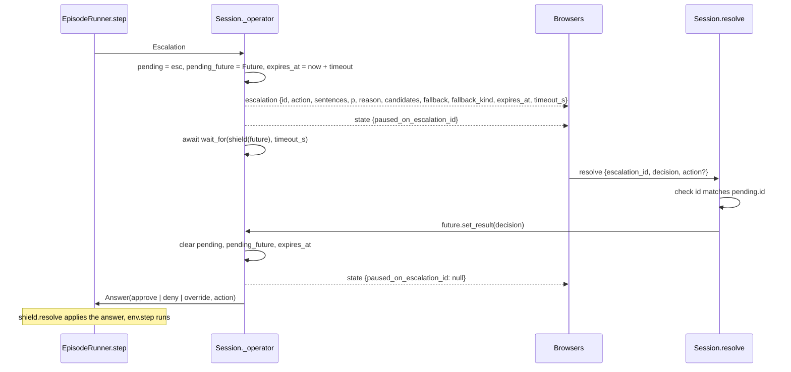

# Server and session

`backend/server.py` is the FastAPI application that the console talks to. It wraps one `EpisodeRunner` in a `Session`, exposes two HTTP routes and one WebSocket endpoint, and drives the simulator between messages. The per-step logic lives in `backend/episode.py` (see [Per-step loop](episode-loop.md)); the server adds transport, pacing, the operator round trip and replay.

```bash
uv run uvicorn backend.server:app --reload                      # server alone
JEV_MODE=mock uv run uvicorn backend.server:app                 # offline
ESCALATION_TIMEOUT_S=0 uv run uvicorn backend.server:app        # wait for the operator
uv run interlock console --jev mock --escalation-timeout 0      # server plus the Vite console
```

## One session per process

The module ends with `app = create_app()`. The lifespan hook builds a single `Session` from the environment and stores it on `app.state.session`. Every WebSocket connection joins that same session, so every browser on the URL sees the same episode and shares the controls. This is a deliberate limit for a demo: the simulator, the loaded DQN and the open escalation are in-memory state, and the loop runs between messages. It is also why the backend runs as one always-on container rather than a serverless function (see [Deployment internals](../deployment-internals.md)).

A read-only viewer would need a per-connection role that the command handler checks before mutating the session. Nothing in the protocol carries that today.

## The `Session` class

| Field | Purpose |
| --- | --- |
| `judge` | The `JevClient` shared by the runner; its `mode` is reported as `judge_mode` |
| `store` | The `ConstraintStore` for the session; survives `reset` so rules persist across seeds |
| `runner` | The `EpisodeRunner`, built with `operator=self._operator` and `operator_name="ui"` |
| `clients` | Open WebSockets; `send` discards a socket that fails |
| `playing`, `done` | Loop flags; `done` is set when the env ends or replay runs out |
| `speed` | Steps per second, default `DEFAULT_STEPS_PER_SEC` (2), clamped to 0.1 to 10 by `set_speed` |
| `timeout_s` | Escalation timeout; `escalation_timeout_s or None`, so 0 becomes None (wait forever) |
| `source` | `"live"` or `"replay"` |
| `pending`, `pending_future`, `pending_expires_at` | The open escalation, the Future the operator resolves, and the wall-clock deadline sent to the UI |
| `logger` | The `JsonlLogger` for the current live run under `backend/logs/runs/` |
| `replay`, `replay_index` | Loaded records and the cursor when the source is replay |
| `records` | This live episode's records, replayed to late joiners as `history` |
| `_task`, `_lock` | The asyncio task that advances the sim and the lock that serializes `_advance` |

### `session_from_env()`

Loads `backend/.env` through `python-dotenv`, then reads:

| Variable | Default | Effect |
| --- | --- | --- |
| `JEV_MODE` | `auto` | `auto` picks `live` when `TYPESAFE_API_KEY` is set, otherwise `mock` |
| `ESCALATION_TIMEOUT_S` | `20` | Seconds before an unanswered escalation is denied; `0` waits forever |
| `MODEL_PATH` | `models/dqn_highway.zip` | The DQN checkpoint `Policy.load` opens |
| `JEV_CACHE_PATH` | `backend/logs/jev_cache.jsonl` | The content cache the judge reads and appends to |
| `SEED` | `0` | Seed of the first episode |

The full table of variables, including the ones only the container sets, is in [Configuration](../../reference/configuration.md).

### `create_app(session=None, *, console_origins=None)`

Tests pass a `Session` built with an untrained policy and a mock judge; production passes nothing and gets `session_from_env()` inside the lifespan. `console_origins=None` reads `CONSOLE_ORIGINS`; an explicit empty list keeps the app same-origin only. On shutdown the lifespan calls `session.close()`, which cancels the loop, closes the log and the Jev client, and closes the env.

## HTTP routes

| Route | Returns |
| --- | --- |
| `GET /health` | `{"ok": true, "judge_mode": "live" or "mock", "source": "live" or "replay", "step": <int>}` |
| `GET /eval/latest` | `{"available": true, ...report}` when `internal/eval/latest.json` exists, otherwise `{"available": false, "message": "run: uv run python -m backend.evaluate --seeds 0-19 --all"}` |

The report shape is in [Evaluation report](../contracts/eval-report.md). The metrics tab fetches this route.

### CORS

`console_origins_from_env()` splits `CONSOLE_ORIGINS` on commas and strips blanks. When the list is non-empty, `CORSMiddleware` is added with those origins and `allow_methods=["GET"]`. Browsers do not apply CORS to the WebSocket upgrade, so the middleware only matters for `/health` and `/eval/latest` when the console is served from another origin (the Vercel deployment). Locally the Vite proxy keeps everything same-origin and the variable stays unset.

## WebSocket lifecycle

`connect(ws)` accepts the socket and sends, in order:

1. `hello`: env config, action names, presets, zone defaults, the list of logged runs and the current constraints and zones.
2. `state`: playing, pause reason, shield, source, judge mode, seed, run id, speed, step, total steps (replay only), done, thresholds.
3. `history`: every record of the current episode (or the replayed prefix), so a refresh mid-run keeps the timeline.
4. `metrics`: the runner's running summary, or counters recomputed from the replayed records.
5. `escalation`: only when one is open, so a late joiner can answer it.

Message bodies are specified in [WebSocket protocol](../contracts/websocket-protocol.md). `disconnect` removes the socket; `broadcast` iterates a copy of `clients` and drops any socket whose send fails.

### The command handler

`handle(ws, msg)` dispatches on `msg["type"]` with a `match`:

| Type | Action |
| --- | --- |
| `play`, `pause`, `step` | `play()`, `pause()`, `step_once()` |
| `reset` | `reset(seed)`, default the current seed |
| `set_speed` | Clamp `steps_per_sec` to 0.1 to 10, broadcast `state` |
| `set_shield` | Set `runner.shield_on`, broadcast `state` |
| `set_thresholds` | Build a new `Thresholds` (which validates `0 <= t_allow <= t_block <= 1`), broadcast `state` |
| `add_constraint`, `toggle_constraint`, `remove_constraint` | Mutate the store, broadcast `constraints` |
| `drop_zone` | `store.drop_zone` at the ego's current x with optional lane, ahead, length and name, broadcast `constraints` |
| `resolve` | `resolve(escalation_id, decision, action)` |
| `load_replay` | `load_replay(run_id)` |
| `load_live` | `reset(current seed)` |
| anything else | `error` with "unknown message type" |

A `KeyError`, `ValueError` or `TypeError` raised by any arm (a missing field, a bad threshold pair, an unknown run) is sent back to that one client as `{"type": "error", "message": "<type>: <exc>"}`. Nothing else is broadcast, and the loop keeps running.

## Pacing the simulator

`play()` sets `playing`, starts `_loop()` as a task if none is running, and broadcasts `state`. `pause()` clears the flag. `step_once()` starts a single `_advance()` task when nothing is in flight and the episode is not done.

`_loop()` repeats while `playing and not done`: record the time, `await _advance()`, then sleep for whatever remains of `1 / speed`. A step that takes longer than the interval (a slow Jev reply, an open escalation) simply delays the next one; there is no catch-up burst.

`_advance()` takes `_lock` and picks `_advance_replay()` or `_advance_live()` by `source`. The lock means a `step` command arriving during a `play` loop cannot interleave two simulator steps.

### `_advance_live()`

1. Snapshot the constraint store.
2. `await runner.step()`, which may block inside the operator callback.
3. Append the record to `records` and broadcast `step`.
4. If the store snapshot changed during the step (a zone was retired and its rule disabled), broadcast `constraints`.
5. Broadcast `metrics`.
6. If the env terminated or truncated, set `done`, clear `playing`.
7. Broadcast `state`.

### `_advance_replay()`

Streams `replay[replay_index]` as a `step`, then a `constraints` message built from the record's own `constraints` and `zones`, then `metrics` recomputed by `replay_metrics` over the prefix, then `state`. When the cursor passes the end, `done` is set and the loop stops.

## The escalation round trip

The runner calls the session's `_operator` coroutine whenever the shield decides `escalate`. The coroutine does not return until the operator answers or the timeout fires, which is what pauses the simulator.



Details that matter:

- `asyncio.shield` wraps the Future so a timeout cancels the wait, not the Future itself; the `finally` block clears the pending fields either way.
- A `TimeoutError` becomes `Answer("deny")`, so an unattended session runs the fallback: the safe action, the least-bad one, or the last resort. With `ESCALATION_TIMEOUT_S=0` there is no timeout and the sim waits indefinitely, which is the setting for a live demo.
- `resolve()` raises `ValueError` for a decision other than `approve`, `deny` or `override`, for an override whose `action` is not one of the escalation's candidates, and for an id that does not match the open escalation. The handler turns that into an `error` reply. A second click on a stale card is therefore harmless.
- `escalation_msg` strips `ground_truth` and `violations_by_action` from the dataclass before sending. The checker's labels never reach the operator.

## Reset, replay and cancellation

`_cancel_inflight()` clears `playing`, cancels and awaits `_task`, and drops any pending escalation. The cancelled task unwinds through `runner.step()`, so no record is written for the interrupted step.

`reset(seed)` cancels in-flight work, then `_reset_runner(seed)`: close the previous logger, `runner.reset(seed)` (new run id of the form `<stamp>_seed<seed>_on|off`), open a new `JsonlLogger` at `backend/logs/runs/<run_id>.jsonl`, clear `done`, set `source` back to `"live"`, and empty `replay` and `records`. The `ConstraintStore` is not touched, so rules and zones carry over. It then broadcasts `hello` (which refreshes the runs list), `state` and `metrics`.

`load_replay(run_id)` resolves `RUNS_DIR / f"{Path(run_id).name}.jsonl"` (the `.name` strips any path components a client might send), reads the records, raises `ValueError` if the file is missing or empty, cancels in-flight work, switches `source` to `"replay"`, and broadcasts `state`, a `constraints` message from the first record, and `metrics`. From there `play` and `step` advance the cursor.

`load_live` is a `reset` on the current seed: a fresh live episode, not a resume.

`list_runs()` returns the stems under `backend/logs/runs/` newest first; it is read on every `hello`.

`replay_metrics(records)` recomputes the running counters (decisions, violations of the executed candidate, human answers, return, crash, cost) from records alone, so replay needs nothing but the log. The same principle drives `backend/metrics.py` (see [Evaluation internals](evaluation.md)).

## Testing hooks

`tests/test_server.py` builds a `Session` with `Policy(build_model(env, seed=0))` and `JevClient(live=None, cache=JevCache(None))`, patches `RUNS_DIR` and the logger's `LOGS_DIR` into a temp directory, and drives the app with FastAPI's `TestClient` over `websocket_connect("/ws")`. See [Testing](../testing.md).
