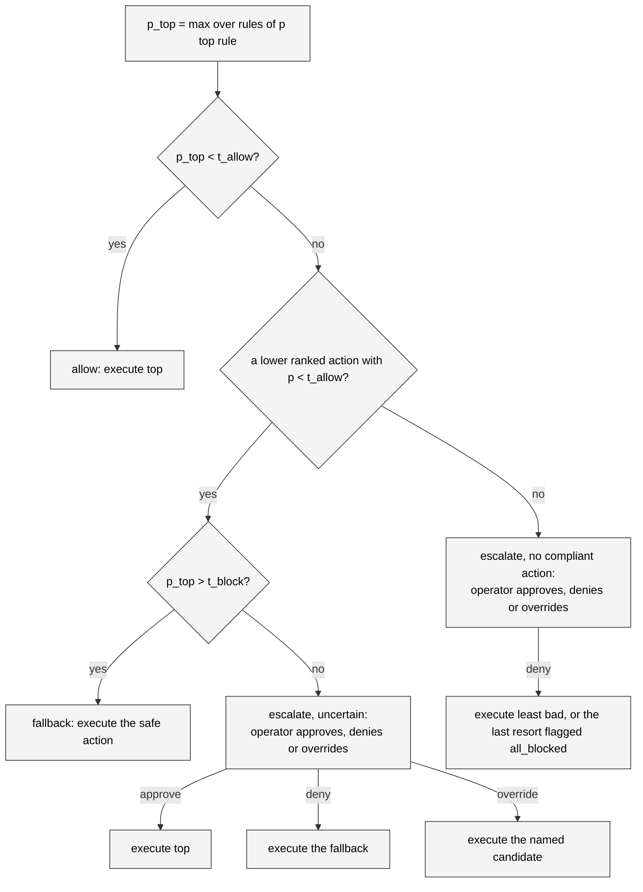

# Shield algorithm

`backend/shield.py` turns a ranking of actions and a grid of violation
probabilities into a decision. It imports nothing from the simulator or the
judge, so every branch is a unit test over plain dicts.

The rule in one sentence: the shield acts on its own only when it holds a
confidently safe action, and otherwise asks a person.

## Inputs

| Name | Type | Meaning |
| --- | --- | --- |
| `ranked` | `list[str]` | The five action names in Q-value order, best first. |
| `p` | `dict[str, dict[str, float]]` | `p[action][constraint_id]` is Jev's probability that executing `action` violates that rule. Only enabled rules appear. |
| `thresholds` | `Thresholds` | `t_allow` and `t_block`, defaults 0.2 and 0.8. |
| `noop` | `frozenset[str]` | Actions that would leave the ego's lane and target speed unchanged: a lane change at the road edge, a speed change at the end of the range. Computed by `facts.noop_actions`. |

`Thresholds` is a frozen dataclass that validates
`0 <= t_allow <= t_block <= 1` on construction and raises `ValueError`
otherwise. The server relies on that to reject a bad `set_thresholds` message.

## The violation probability of an action

```python
def violation_probability(p_for_action: dict[str, float]) -> tuple[float, str | None]
```

The violation probability of an action is the maximum over the enabled rules,
and the function also returns which rule produced it. With no rules the result
is `0.0` and `None`, so an empty rule set allows everything. The rule behind
the maximum on the proposed action becomes `fired_constraint` in the record,
the "fired" label in the inspector, and the rule shown on the approval card.

## The fallback search

```python
def fallback_action(ranked, p, thresholds, noop=frozenset()) -> Fallback
```

The fallback is what deny would execute. It is found in three tiers and the
`Fallback` value names the tier in `kind`:

| Kind | Rule |
| --- | --- |
| `safe` | The first action in `ranked[1:]` whose violation probability is strictly below `t_allow`. |
| `least_bad` | No lower-ranked action is confidently safe. Take the lower-ranked action with the lowest violation probability among those at or below `t_block` and not in `noop`. Ties go to the policy's ranking. |
| `last_resort` | Nothing qualifies. `SLOWER` if its own probability is at most `t_block`, otherwise `IDLE`. |

The fallback is computed on every call, not only when it is needed, because
the `Decision` carries it for the escalation path and the record stores it.
The approval card tells the operator what deny will execute, and in which
tier, before they choose.

The no-op exclusion exists because of a measured failure: the SLOWER last
resort at the lowest target speed changes nothing, so a state where every
action violates some rule repeated itself for dozens of steps while the
shield kept "falling back" (plan section 16.1).

## Decision rules

```python
def decide(ranked, p, thresholds, noop=frozenset()) -> Decision
```

With `top = ranked[0]`, `p_top` its violation probability and `fb` the
fallback:

| Condition | Kind | Reason | Executed |
| --- | --- | --- | --- |
| `p_top < t_allow` | `allow` | | `top` |
| `fb.kind != "safe"` | `escalate` | `no_compliant_action` | `top` until the operator answers |
| `p_top > t_block` | `fallback` | | `fb.action`, the safe one |
| otherwise (`t_allow <= p_top <= t_block`) | `escalate` | `uncertain` | `top` until the operator answers |

The rows are tried in order. The second row is the Oct 17 change: when no
candidate is confidently safe, the shield no longer executes a last resort on
its own, whatever `p_top` is. It escalates, the queue shows every candidate,
and the operator may approve the proposal, deny it or override with any
candidate. The uncertain band is still inclusive at both ends.

The decision kind `all_blocked` is no longer produced. It remains in the type
so older logs replay, and the `all_blocked` flag still marks an executed last
resort after a deny or a timeout.



!!! warning "The shield enforces rules, not collision safety"
    The fallback tiers are chosen by rule probability alone. The policy's own
    crash avoidance is not a rule, so a deny can override a lane change the
    policy wanted for safety reasons. A following-distance rule belongs in
    the rule set if that matters, and an unattended default-deny is a bad
    idea in a live run, which is why the deployment sets
    `ESCALATION_TIMEOUT_S=0`. A code-side time-to-collision floor is planned
    as item C of the upgrade plan.

## The Decision value

```python
@dataclass(frozen=True)
class Decision:
    kind: DecisionKind              # allow | fallback | escalate (all_blocked only in old logs)
    proposed: str                   # ranked[0]
    executed: str                   # what runs; for an open escalation, the proposed action
    fired_constraint: str | None
    p_proposed: float
    p_viol: dict[str, float]        # violation probability per action
    fallback: str                   # what deny would execute
    fallback_kind: FallbackKind     # safe | least_bad | last_resort
    reason: EscalationReason | None # uncertain | no_compliant_action, on escalations only
    all_blocked: bool = False       # the executed action came from the last resort
```

`p_viol` is kept for the whole ranking so the record, the inspector and the
approval card can show the shield's view of every candidate, not only the top
one.

## Resolving an escalation

```python
@dataclass(frozen=True)
class Answer:
    decision: Literal["approve", "deny", "override"]
    action: str | None = None       # the candidate to run, for override

def resolve(decision: Decision, answer: Answer) -> Decision
```

Only an `escalate` decision can be resolved; anything else raises
`ValueError`. Approve returns a copy with `executed = proposed`. Deny returns a
copy with `executed = fallback` and `all_blocked` set when the fallback was
the last resort. Override returns a copy with `executed` set to the named
action, which must be one of the ranked candidates, and raises `ValueError`
otherwise. In every case `kind` stays `escalate`: the record's `decision`
field says what the shield decided, and `executed`, `all_blocked` and `human`
say what happened after the person answered.

## Shadow mode

Shield off does not skip this module. `EpisodeRunner.step()` still calls
`decide()`, then replaces the result with an `allow` that executes the
proposed action and clears the reason. The probabilities, the fired rule and
the would-be fallback with its kind are all in the record, which is what makes
a shield-off run a valid source of calibration data and a fair before/after
baseline.

## Two worked examples

Take the three standing rules at the default thresholds and this grid, with
the ranking `FASTER, IDLE, LANE_RIGHT, SLOWER, LANE_LEFT`:

| Action | speed limit | lane change gap | left lane for passing | max |
| --- | --- | --- | --- | --- |
| FASTER | 0.93 | 0.05 | 0.22 | 0.93 |
| IDLE | 0.05 | 0.06 | 0.22 | 0.22 |
| LANE_RIGHT | 0.09 | 0.08 | 0.15 | 0.15 |
| SLOWER | 0.07 | 0.04 | 0.11 | 0.11 |
| LANE_LEFT | 0.05 | 0.80 | 0.60 | 0.80 |

`p_top` is 0.93 on the speed rule. `IDLE` sits at 0.22, inside the band, so it
is skipped; `LANE_RIGHT` at 0.15 is below `t_allow` and becomes the safe
fallback. The decision is `fallback`, executed `LANE_RIGHT`, fired constraint
the speed rule.

Now the conflict that the eval logs showed at seed 10, step 24, with the
ranking `FASTER, IDLE, SLOWER, LANE_RIGHT, LANE_LEFT`. The ego is in lane 1
at the lowest target speed with a car alongside in lane 2:

| Action | speed limit | lane change gap | left lane for passing | max | no-op |
| --- | --- | --- | --- | --- | --- |
| FASTER | 0.16 | 0.06 | 0.55 | 0.55 | |
| IDLE | 0.04 | 0.04 | 0.66 | 0.66 | |
| SLOWER | 0.04 | 0.05 | 0.58 | 0.58 | yes, already at 20 m/s |
| LANE_RIGHT | 0.03 | 0.78 | 0.11 | 0.78 | |
| LANE_LEFT | 0.03 | 0.04 | 0.41 | 0.41 | yes, already in lane 1 |

No action is below `t_allow`, so the fallback is least bad: among the
non-no-op lower-ranked actions at or below `t_block`, `IDLE` at 0.66 beats
`LANE_RIGHT` at 0.78. The decision is `escalate` with reason
`no_compliant_action`, and the queue lists all five. Before Oct 17 this step
executed `SLOWER`, which changed nothing, and the same step repeated 37 times.

## Choosing thresholds

The thresholds are data, not code. The console exposes them as sliders, and
`interlock eval --sweep` measures five pairs from 0.1 / 0.9 to 0.5 / 0.5 so
the tradeoff between violations and operator load can be read off a plot.
The [evaluation page](../../user-guide/evaluation.md) shows the measured
curve; the [configuration reference](../../reference/configuration.md) lists
the defaults.

## Tests

`tests/test_shield.py` covers threshold validation, allow, fallback to the
first safe lower rank, the inclusive band, the three fallback tiers with the
no-op exclusion and rank tie-break, the no-compliant-action escalation, the
fired constraint being the maximum, the empty rule set, and `resolve` for
approve, deny, override, a bad override and the denied-into-all-blocked case.
