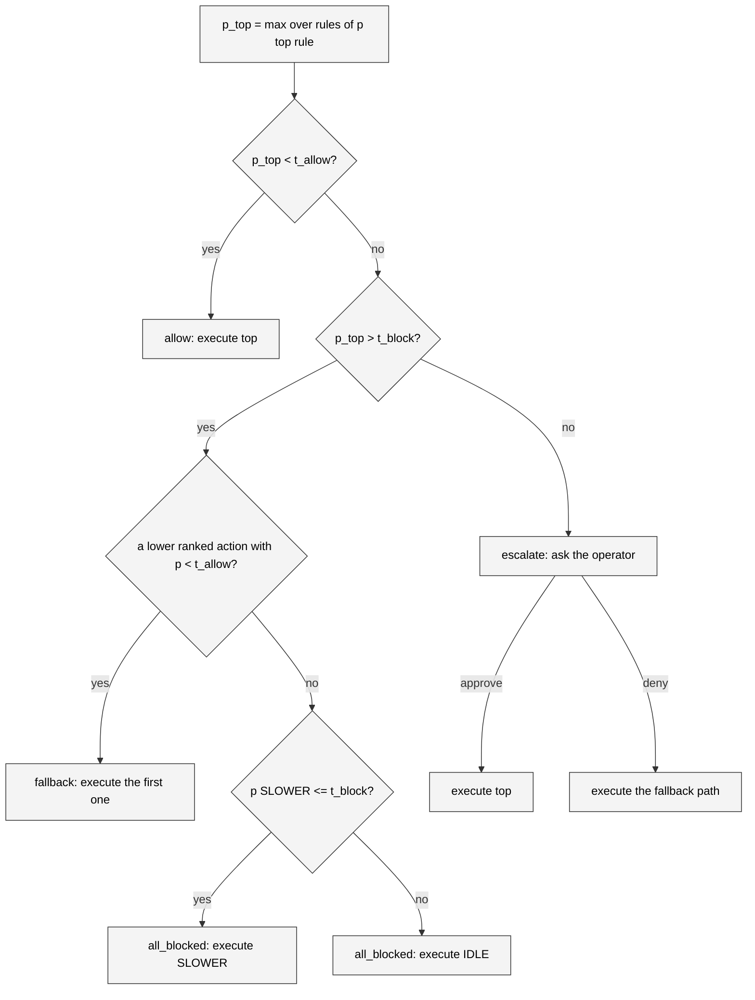

# Shield algorithm

`backend/shield.py` turns a ranking of actions and a grid of violation
probabilities into one of four outcomes. It imports nothing from the
simulator or the judge, so every branch is a unit test over plain dicts.

## Inputs

| Name | Type | Meaning |
| --- | --- | --- |
| `ranked` | `list[str]` | The five action names in Q-value order, best first. |
| `p` | `dict[str, dict[str, float]]` | `p[action][constraint_id]` is Jev's probability that executing `action` violates that rule. Only enabled rules appear. |
| `thresholds` | `Thresholds` | `t_allow` and `t_block`, defaults 0.2 and 0.8. |

`Thresholds` is a frozen dataclass that validates
`0 <= t_allow <= t_block <= 1` on construction and raises `ValueError`
otherwise. The server relies on that to reject a bad `set_thresholds` message.

## The violation probability of an action

```python
def violation_probability(p_for_action: dict[str, float]) -> tuple[float, str | None]
```

The violation probability of an action is the maximum over the enabled rules,
and the function also returns which rule produced it. With no rules the result
is `0.0` and `None`, so an empty rule set allows everything. The rule behind
the maximum on the proposed action becomes `fired_constraint` in the record,
the "fired" label in the inspector, and the rule shown on the approval card.

## Decision rules

```python
def decide(ranked, p, thresholds) -> Decision
```

With `top = ranked[0]` and `p_top` its violation probability:

| Condition | Kind | Executed |
| --- | --- | --- |
| `p_top < t_allow` | `allow` | `top` |
| `p_top > t_block` and a fallback exists | `fallback` | the first lower-ranked action with violation probability `< t_allow` |
| `p_top > t_block` and no fallback exists | `all_blocked` | `SLOWER` if its violation probability is `<= t_block`, else `IDLE` |
| otherwise (`t_allow <= p_top <= t_block`) | `escalate` | `top` until the operator answers |

The uncertain band is inclusive at both ends. A probability exactly equal to
either threshold escalates.



### The fallback search

```python
def fallback_action(ranked, p, thresholds) -> tuple[str, bool]
```

The search walks `ranked[1:]` in Q order and returns the first action whose
violation probability is strictly below `t_allow`, with `False` for "not the
last resort". Actions in the uncertain band are skipped: the shield never
falls back onto something it would itself have escalated. When nothing
qualifies, the last resort is `SLOWER` when its own probability is at most
`t_block`, otherwise `IDLE`, and the flag is `True`.

The fallback is computed on every call, not only when it is needed, because
the `Decision` carries it for the escalation path: the approval card tells the
operator what deny will execute before they choose.

!!! warning "The shield enforces rules, not collision safety"
    The fallback and the last resort are chosen by rule probability alone.
    The policy's own crash avoidance is not a rule, so a deny or an
    all-blocked step can override a lane change the policy wanted for safety
    reasons. A following-distance rule belongs in the rule set if that
    matters, and an unattended default-deny is a bad idea in a live run,
    which is why the deployment sets `ESCALATION_TIMEOUT_S=0`.

## The Decision value

```python
@dataclass(frozen=True)
class Decision:
    kind: DecisionKind          # allow | fallback | escalate | all_blocked
    proposed: str               # ranked[0]
    executed: str               # what runs; for an open escalation, the proposed action
    fired_constraint: str | None
    p_proposed: float
    p_viol: dict[str, float]    # violation probability per action
    fallback: str               # what the fallback path would execute
    fallback_all_blocked: bool  # that fallback is the SLOWER / IDLE last resort
    all_blocked: bool = False   # the executed action came from the last resort
```

`p_viol` is kept for the whole ranking so the record and the inspector can
show the shield's view of every candidate, not only the top one.

## Resolving an escalation

```python
def resolve(decision: Decision, approved: bool) -> Decision
```

Only an `escalate` decision can be resolved; anything else raises
`ValueError`. Approve returns a copy with `executed = proposed`. Deny returns a
copy with `executed = fallback` and `all_blocked = fallback_all_blocked`, so a
denied escalation whose fallback was the last resort is marked all blocked in
the record even though its `kind` stays `escalate`. The record's `decision`
field therefore says what the shield decided, and `executed` plus
`all_blocked` say what happened after the human answered.

## Shadow mode

Shield off does not skip this module. `EpisodeRunner.step()` still calls
`decide()`, then replaces the result with an `allow` that executes the
proposed action. The probabilities, the fired rule and the would-be fallback
are all in the record, which is what makes a shield-off run a valid source of
calibration data and a fair before/after baseline.

## A worked example

Take the three standing rules at the default thresholds and this grid, with
the ranking `FASTER, IDLE, LANE_RIGHT, SLOWER, LANE_LEFT`:

| Action | speed limit | lane change gap | left lane for passing | max |
| --- | --- | --- | --- | --- |
| FASTER | 0.93 | 0.05 | 0.22 | 0.93 |
| IDLE | 0.05 | 0.06 | 0.22 | 0.22 |
| LANE_RIGHT | 0.09 | 0.08 | 0.15 | 0.15 |
| SLOWER | 0.07 | 0.04 | 0.11 | 0.11 |
| LANE_LEFT | 0.05 | 0.80 | 0.60 | 0.80 |

`p_top` is 0.93 on the speed rule, above `t_block`, so the shield looks for a
fallback. `IDLE` sits at 0.22, inside the band, so it is skipped.
`LANE_RIGHT` at 0.15 is below `t_allow` and becomes the fallback. The decision
is `fallback`, executed `LANE_RIGHT`, fired constraint the speed rule. Had
`LANE_RIGHT` also been in the band, `SLOWER` at 0.11 would have been chosen
through the normal search, still not the last resort. The last resort only
appears when every lower-ranked action is at or above `t_allow`.

## Choosing thresholds

The thresholds are data, not code. The console exposes them as sliders, and
`interlock eval --sweep` measures five pairs from 0.1 / 0.9 to 0.5 / 0.5 so
the tradeoff between violations and operator load can be read off a plot.
The [evaluation page](../../user-guide/evaluation.md) shows the measured
curve; the [configuration reference](../../reference/configuration.md) lists
the defaults.

## Tests

`tests/test_shield.py` covers threshold validation, allow, fallback to the
first safe lower rank, the inclusive band, the last resort preferring SLOWER
then IDLE, the fired constraint being the maximum, the empty rule set, and
`resolve` for approve, deny and the denied-into-all-blocked case.
