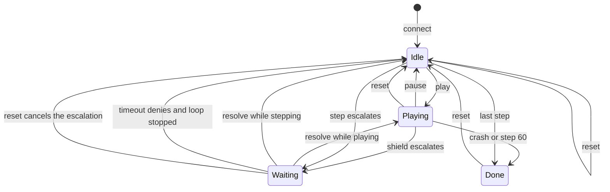
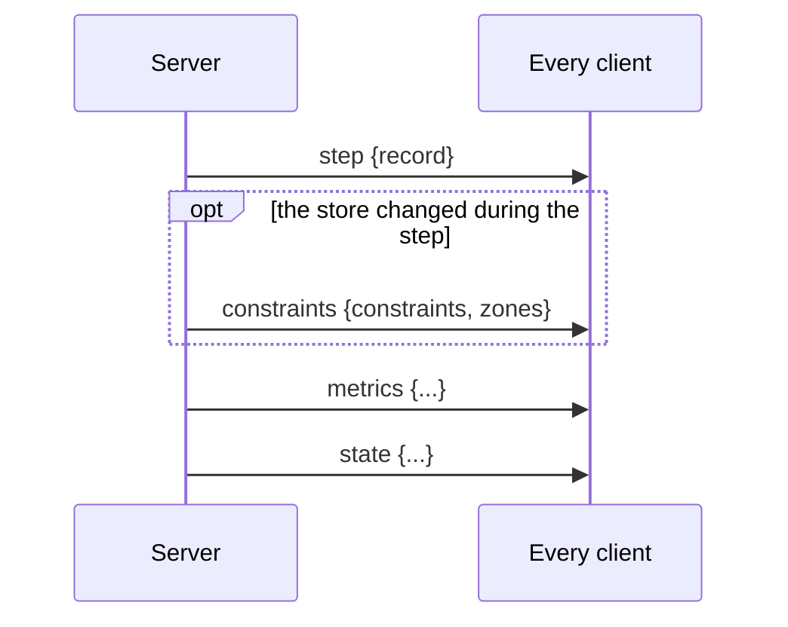

# WebSocket protocol

The console and the server talk over one WebSocket at `/ws`. Every message is
a JSON object with a `type` field. The server broadcasts state to every
connected browser; any browser can send a command. This page lists both
directions, the order the server guarantees on connect, and the state machine
behind the play loop. The server side is in `backend/server.py`, the client
side in `frontend/src/ws-client.ts`, and the types in `frontend/src/types.ts`.

## Connection

The client opens `ws://<host>/ws` (or `wss` when the page or
`VITE_BACKEND_URL` is https). On accept the server sends, in this order:

1. `hello`
2. `state`
3. `history` with this episode's records so far
4. `metrics`
5. `escalation`, only if one is open

A browser refresh in the middle of an episode therefore gets its timeline
back. The client reconnects on close with exponential backoff from 500 ms to
5 s and receives the same greeting again.

There is one session per server process. Every connected browser sees the
same episode, and a command from any of them applies to all.

## Server to client

| Type | Fields | When |
| --- | --- | --- |
| `hello` | `config` (`lanes_count`, `duration`, `vehicles_count`, `policy_frequency`, `action_names`, `steps_per_sec`, `escalation_timeout_s`), `presets` (list of `{checker, text}`), `zone_defaults` (`{lane, ahead_m, length_m, name}`), `runs` (replayable run ids, newest first), `constraints`, `zones` | On connect and after every `reset`, so the run list refreshes. |
| `state` | `playing`, `paused_on_escalation_id`, `shield_on`, `source` (`live` or `replay`), `judge_mode` (`live` or `mock`), `episode`, `seed`, `run_id`, `speed`, `step`, `total_steps` (replay only, else `null`), `done`, `thresholds`, `floor_s` (the time-to-collision floor in seconds, 0 when off; set at launch, no message changes it) | After every step and every transition: play, pause, speed, shield, thresholds, escalation open or closed, reset, replay load. |
| `history` | `records`: list of log records | On connect. In replay, the records already streamed. |
| `step` | `record`: one log record | After each live step or each replayed record. |
| `escalation` | `escalation`: `id`, `step`, `action`, `sentences`, `constraint_id`, `constraint_text`, `p`, `q_rank`, `fallback`, `fallback_kind` (`safe`, `least_bad` or `last_resort`), `judge_unavailable`, `reason` (`uncertain` or `no_compliant_action`), `candidates` (every ranked action as `{action, rank, p, constraint_id, noop}`, rank 0 the proposal), `expires_at` (epoch seconds or `null`), `timeout_s` (`null` when waiting forever) | When the shield escalates, and on connect while one is open. `ground_truth` and `violations_by_action` are stripped before sending. |
| `constraints` | `constraints`, `zones` | After any rule or zone command, after a step that changed the store (a zone retired), and on each replayed record from the record's own lists. |
| `metrics` | The runner summary: `run_id`, `seed`, `shield_on`, `judge_mode`, `steps`, `return`, `crashed`, `decisions`, `conflicts` (escalations with no compliant action), `violations`, `violations_total`, `human` (counts of `approve`, `deny` and `override`), `judge_sources`, `latency_ms_p50`, `latency_ms_p95`, `input_tokens`, `cost_usd`. In replay, `replay_metrics` recomputed from the records streamed so far, without the latency and token fields. | On connect, after every step, after reset and after a replay load. |
| `twin` | `seed`, `run_id`, `rules` (enabled rules in that log), `steps` (one per step: `{step, ego, vehicles, executed, violations, violations_so_far, crashed}`), `violations_total`, `crashed_at` (step or `null`) | On connect, after every `reset` and after a replay load: the newest shield-off log for the seed, from `backend/logs/eval/*_off/seedN.jsonl` first and `backend/logs/runs/*_seedN_off.jsonl` second. `steps` is empty when there is none, and the console hides the strip. |
| `error` | `message` | For an unknown message type or a command that raised `KeyError`, `ValueError` or `TypeError`, for example a bad threshold pair or an unknown constraint id. Sent only to the sender. |

A `step` message carries the full [log record](log-record.md), so a client
needs nothing else to render the road, the timeline and the inspector.

## Client to server

| Type | Fields | Effect |
| --- | --- | --- |
| `play` | | Start the loop. Ignored when already playing or when the episode is done. |
| `pause` | | Stop after the current step. |
| `step` | | Advance one step. Ignored while a step is in flight or the episode is done. |
| `reset` | `seed` | Cancel anything in flight, start a new episode on that seed with a new run id and log file, keep the rules and zones, return to the live source. |
| `set_speed` | `steps_per_sec` | Clamped to 0.1 to 10. |
| `set_shield` | `on` | Takes effect from the next step. |
| `set_thresholds` | `t_allow`, `t_block` | Validated by `Thresholds`; an invalid pair returns an `error`. |
| `add_constraint` | `text`, optional `checker` | Adds a rule; the checker is inferred from the text when omitted. |
| `toggle_constraint` | `id`, `enabled` | |
| `remove_constraint` | `id` | |
| `drop_zone` | optional `lane`, `ahead_m`, `length_m`, `name` | Places a zone ahead of the ego and arms the lane-closed rule. Defaults are lane 3, 120 m ahead, 200 m long, "work zone". |
| `resolve` | `escalation_id`, `decision` (`approve`, `deny` or `override`), `action` (required for `override`) | Answers the open escalation. Approve runs the proposal, deny the fallback, override the named action. An id that does not match the open one, or an override whose `action` is not one of the escalation's `candidates`, returns an `error`. |
| `load_replay` | `run_id` | Switch to replaying that run from `backend/logs/runs/`. |
| `load_live` | | Leave replay by resetting the live episode on its current seed. |

Replay accepts `play`, `pause`, `step`, `set_speed` and the two load
commands. The console disables the other controls in replay; the server does
not reject them, but they affect the live session that resumes on `load_live`.

## Session state machine



The `state` message exposes this as `playing`, `paused_on_escalation_id` and
`done`:

| State | `playing` | `paused_on_escalation_id` | `done` |
| --- | --- | --- | --- |
| Idle | `false` | `null` | `false` |
| Playing | `true` | `null` | `false` |
| Waiting on the operator | `true` or `false` (whatever it was) | the escalation id | `false` |
| Done | `false` | `null` | `true` |

While an escalation is open the loop is suspended inside the step, so no
further `step` messages arrive until it is resolved or the timeout fires. The
timeout comes from `ESCALATION_TIMEOUT_S`; 0 means wait forever and
`expires_at` is `null`.

## Message order during one live step



When the step escalates, `escalation` and `state` are sent before the step
completes, then after resolution another `state`, and finally the sequence
above.

## Examples

A client adding a preset and answering an escalation:

```json
{"type": "add_constraint", "text": "Speed limit 25 m/s", "checker": "speed_limit"}
{"type": "step"}
{"type": "resolve", "escalation_id": "2026-10-17T01-10-01_seed0_on-4", "decision": "deny"}
```

An override names the candidate to run:

```json
{"type": "resolve", "escalation_id": "2026-10-17T01-10-01_seed0_on-4", "decision": "override", "action": "LANE_RIGHT"}
```

The server's `escalation` for that step:

```json
{
  "type": "escalation",
  "escalation": {
    "id": "2026-10-17T01-10-01_seed0_on-4",
    "step": 4,
    "action": "LANE_LEFT",
    "sentences": ["Ego speed 24.9 m/s, target 25 m/s, lane 4 of 4 (numbered from the left).", "..."],
    "constraint_id": "c2",
    "constraint_text": "No lane change if a vehicle is within 10 m in the target lane",
    "p": 0.66,
    "q_rank": 0,
    "fallback": "SLOWER",
    "fallback_kind": "safe",
    "judge_unavailable": false,
    "reason": "uncertain",
    "candidates": [
      {"action": "LANE_LEFT", "rank": 0, "p": 0.66, "constraint_id": "c2", "noop": false},
      {"action": "IDLE", "rank": 1, "p": 0.31, "constraint_id": "c3", "noop": false},
      {"action": "SLOWER", "rank": 2, "p": 0.05, "constraint_id": "c1", "noop": false},
      {"action": "FASTER", "rank": 3, "p": 0.93, "constraint_id": "c1", "noop": false},
      {"action": "LANE_RIGHT", "rank": 4, "p": 0.04, "constraint_id": "c1", "noop": true}
    ],
    "expires_at": null,
    "timeout_s": null
  }
}
```

`reason` is `no_compliant_action` when no candidate scores below the allow
threshold; the console then lists the candidates as the main choice. `noop`
marks a lane change at the road edge or a speed change at the end of the
speed range, which the shield never picks as a least-bad fallback.

An error reply:

```json
{"type": "error", "message": "set_thresholds: need 0 <= t_allow <= t_block <= 1, got 0.9, 0.1"}
```

## HTTP routes

Two plain routes sit next to the socket. `GET /health` returns `ok`,
`judge_mode`, `source` and the current `step`. `GET /eval/latest` returns the
evaluation report with `available: true`, or `available: false` and a message
naming the command that produces one. These are the only routes that need
CORS when the console is on another origin; the WebSocket upgrade is exempt.
See [Server and session](../backend/server.md).

## Changing the protocol

Add the message to `Session` and the broadcast call sites in
`backend/server.py`, mirror it in `ServerMessage` or `ClientMessage` in
`frontend/src/types.ts`, handle it in `apply()` in `frontend/src/ws-client.ts`
or send it from a component, and pin it in `tests/test_server.py`. The
[extending page](../extending.md) walks through both directions.
