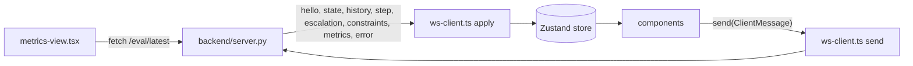

# Frontend overview

The console is a static Vite build in `frontend/`. It holds no server state of its own: one WebSocket feeds one Zustand store, and every component reads the store and sends commands back over the same socket. This page maps the files and the data flow; the store, the components and the socket client each have their own page.

## Stack

| Package | Version | Role |
| --- | --- | --- |
| `react`, `react-dom` | 19.3 | UI, rendered under `StrictMode` |
| `vite`, `@vitejs/plugin-react` | 8.3, 6.1 | Dev server, proxy, production build |
| `typescript` | 7.0 | Strict type checking, `pnpm typecheck` |
| `tailwindcss`, `@tailwindcss/vite` | 4.3 | Utility classes, imported once in `styles.css` |
| `zustand` | 5.0 | The single store |
| `recharts` | 3.10 | The four charts on the metrics tab |
| `@playwright/test` | 1.64 | The smoke test in `frontend/e2e/` |

Scripts in `package.json`: `dev`, `build` (`tsc` then `vite build`), `typecheck`, `preview`, `test:e2e`.

## File map

| File | Purpose |
| --- | --- |
| `src/main.tsx` | Mounts `App` under `StrictMode` and imports `styles.css` |
| `src/app.tsx` | Layout, the socket `connect()` effect, the keyboard handler, the error toast |
| `src/backend-url.ts` | `httpUrl()` and `wsUrl()` from the build-time `VITE_BACKEND_URL` |
| `src/ws-client.ts` | One socket, reconnect, `apply()` server messages to the store, `send()` |
| `src/store.ts` | The Zustand store: five slices and the step selectors |
| `src/types.ts` | TypeScript mirror of the log record, the protocol and the eval report |
| `src/format.ts` | Number formatters, the decision labels, classes and colors, `isLaneNoop()` and `uiScale()` |
| `src/icons.tsx` | Inline SVG icons for the transport, navigation and close buttons |
| `src/styles.css` | Tailwind import, the `@theme` tokens (fonts, sizes, outcome colors), the shared control classes, the density rule |
| `src/components/status-strip.tsx` | Header: source menu, transport, shield switch, status slot, density and shortcut buttons, live stats or report metadata |
| `src/components/road-view.tsx` | Canvas 2D road, ego-centered, interpolated between steps, with a DOM HUD and legend over it |
| `src/components/twin-strip.tsx` | The unshielded twin under the road view |
| `src/components/decision-strip.tsx` | One tick per step with an axis, hover card and the twin's violations; click to inspect |
| `src/components/inspector-drawer.tsx` | Candidates, probability grid, facts table, raw Jev exchange |
| `src/components/facts-table.tsx` | One candidate's facts as labelled pairs and a lanes table |
| `src/components/approval-queue.tsx` | The open escalation with approve, deny and override |
| `src/components/constraint-panel.tsx` | Rules, presets, zones |
| `src/components/threshold-band.tsx` | The two-handle threshold band |
| `src/components/metrics-view.tsx` | The evaluation report as tiles, charts and tables |
| `src/components/toasts.tsx` | Server errors, top center, self-clearing |
| `src/components/shortcuts-overlay.tsx` | The keyboard shortcut list |
| `e2e/smoke.spec.ts` | Three Playwright tests |

## Data flow



Three rules keep this simple:

1. Server state enters only through `apply()` in `ws-client.ts`. No component parses a message.
2. Components keep local state only for things the server does not own: the seed input before reset, a slider before commit, the inspector's chosen candidate and tab, a countdown clock.
3. Commands go out only through `send()`. A component never holds a socket.

See [Store and selectors](store.md), [Components](components.md) and [Socket client](socket-client.md).

## Layout

`app.tsx` renders a full-height flex column:

```text
StatusStrip
view === "metrics"
  ? MetricsView
  : row
      column (flex-1): RoadView, (selectedStep !== null ? InspectorDrawer : TwinStrip), DecisionStrip
      aside (clamp(20rem, 27vw, 25rem), scrolls): ApprovalQueue, ConstraintPanel
Toasts (fixed, top center, when errors is not empty)
ShortcutsOverlay (fixed, centered, when shortcutsOpen)
```

The inspector takes the twin's slot while a step is selected and is capped at `min(22rem, 42vh)`, so the decisions strip, the only way to move between steps, never leaves the screen. The road view has no minimum beyond 15rem and absorbs the rest. The `view` field in the store switches between the console and the metrics tab; the status strip stays on both and swaps its middle for the report's metadata.

## Styling

`styles.css` imports Tailwind 4 and declares the design tokens in `@theme`: `--font-sans` (Inter or the system face) for prose and labels, `--font-mono` (JetBrains Mono or the system monospace) for numbers, action names, ids and JSON, a `text-2xs` size of 11 px that is the floor for any text, the four outcome colors (`allow`, `fallback`, `escalate`, `blocked`), `hazard` for work zones and `accent` for interactive chrome and the ego car. Every size is in rem, so `html[data-density="talk"]`, which raises the root font size by 15 percent, scales the whole console; canvas text reads the same factor through `uiScale()`. `color-scheme: dark` makes native selects and ranges render dark, and `:focus-visible` draws the accent ring.

The shared classes, and what each one means:

| Class | Use |
| --- | --- |
| `panel`, `panel-title`, `panel-subtitle` | Card, its title row, and the quieter right-hand text in the title |
| `btn`, `btn-primary`, `btn-danger`, `btn-icon` | Buttons act |
| `chip`, `chip-on` | Chips choose: presets, candidates, tabs |
| `badge` | Badges report; never clickable |
| `switch`, `switch-knob` | Switches toggle: the shield, each rule |
| `stat-label`, `num`, `kbd` | Small uppercase label, mono tabular number, key cap |
| `enter`, `pulse` | 150 ms rise for cards and drawers; the reconnecting dot |
| `band-range` | The two overlaid range inputs of the threshold band |
| `talk-hide` | Hidden at talk density so the header keeps one row |

Outcome colors come from `format.ts` as both classes and hex, so the canvas, the timeline and the badges agree: green for allow, amber for fallback, violet for escalate, rose for all blocked. They are used only for outcomes; a top candidate removed by the physics floor is drawn in amber because the floor is code, not a rule. The metrics charts use a separate palette of blue for shield on, orange for shield off and aqua for the third checker.

## Backend URL

`backend-url.ts` reads `import.meta.env.VITE_BACKEND_URL` at build time and strips trailing slashes.

- Set, `httpUrl("/eval/latest")` goes to that origin and `wsUrl()` swaps the scheme to `ws` or `wss` and appends `/ws`. This is the Vercel build pointing at the Fly.io backend.
- Unset, fetches stay on the page's origin and the socket uses `ws` or `wss` to match `location.protocol`. In development the Vite proxy in `vite.config.ts` forwards `/ws`, `/health` and `/eval` to `SHIELD_BACKEND`, default `http://127.0.0.1:8000`. The smoke test sets `SHIELD_BACKEND` to its own backend on 8001.

Browsers do not apply CORS to the WebSocket upgrade, so the cross-origin case needs the backend's `CONSOLE_ORIGINS` only for the two HTTP routes. See [Deployment internals](../deployment-internals.md).

## Keyboard handler

`app.tsx` installs one `keydown` listener on `window` and ignores events whose target is an input, textarea or select. It reads the store with `useStore.getState()` so the handler never re-subscribes.

| Key | Action |
| --- | --- |
| ++space++ | `pause` when playing, else `play`; default scrolling prevented |
| ++n++ | `step` |
| ++a++, ++d++ | `resolve` the open escalation as approve or deny |
| ++1++ to ++5++ | `resolve` the open escalation with the candidate of that rank: rank 1 approves, the rest override |
| ++arrow-left++ | Select the previous step; from live, select the last step |
| ++arrow-right++ | Select the next step; past the last step returns to live |
| ++esc++ | Close the shortcut list if open, else deselect and follow live |
| ++question++ | Toggle the shortcut list |

Events with a modifier key held are ignored, so browser shortcuts still work.

## Toasts

`pushError` keeps the last five messages. Anything the server rejects (an unknown message type, a bad threshold pair, a missing replay) arrives as an `error` message and shows in `toasts.tsx`, fixed at the top center under the strip. An effect clears the list six seconds after the last message; the "×" clears it sooner. `send()` pushes its own "not connected to the server" entry when the socket is not open, and the strip's dot pulses red with "reconnecting" while `connected` is false.

## TypeScript configuration

`tsconfig.json` targets ES2022 with bundler resolution and `noEmit`. Beyond `strict`, it enables `noUnusedLocals`, `noUnusedParameters`, `noFallthroughCasesInSwitch`, `noUncheckedIndexedAccess`, `useUnknownInCatchVariables`, `isolatedModules` and `moduleDetection: force`. `noUncheckedIndexedAccess` is why array reads such as `s.steps[s.steps.length - 1]` carry `?? null` and why `record.candidates[0]?.action` is optional everywhere.

Filenames are kebab-case. Component files export one named component matching the file: `status-strip.tsx` exports `StatusStrip`.
