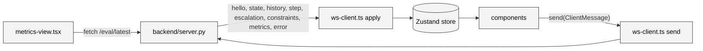

# Frontend overview

The console is a static Vite build in `frontend/`. It holds no server state of its own: one WebSocket feeds one Zustand store, and every component reads the store and sends commands back over the same socket. This page maps the files and the data flow; the store, the components and the socket client each have their own page.

## Stack

| Package | Version | Role |
| --- | --- | --- |
| `react`, `react-dom` | 19.3 | UI, rendered under `StrictMode` |
| `vite`, `@vitejs/plugin-react` | 8.3, 6.1 | Dev server, proxy, production build |
| `typescript` | 7.0 | Strict type checking, `pnpm typecheck` |
| `tailwindcss`, `@tailwindcss/vite` | 4.3 | Utility classes, imported once in `styles.css` |
| `zustand` | 5.0 | The single store |
| `recharts` | 3.10 | The four charts on the metrics tab |
| `@playwright/test` | 1.64 | The smoke test in `frontend/e2e/` |

Scripts in `package.json`: `dev`, `build` (`tsc` then `vite build`), `typecheck`, `preview`, `test:e2e`.

## File map

| File | Purpose |
| --- | --- |
| `src/main.tsx` | Mounts `App` under `StrictMode` and imports `styles.css` |
| `src/app.tsx` | Layout, the socket `connect()` effect, the keyboard handler, the error toast |
| `src/backend-url.ts` | `httpUrl()` and `wsUrl()` from the build-time `VITE_BACKEND_URL` |
| `src/ws-client.ts` | One socket, reconnect, `apply()` server messages to the store, `send()` |
| `src/store.ts` | The Zustand store: five slices and the step selectors |
| `src/types.ts` | TypeScript mirror of the log record, the protocol and the eval report |
| `src/format.ts` | Number formatters and the decision labels, classes and colors |
| `src/styles.css` | Tailwind import, the theme font and six shared utility classes |
| `src/components/status-strip.tsx` | Header: transport, playback, shield toggle, replay picker, live stats |
| `src/components/road-view.tsx` | Canvas 2D road, ego-centered, interpolated between steps |
| `src/components/decision-strip.tsx` | One tick per step, click to inspect |
| `src/components/inspector-drawer.tsx` | Candidates, probability grid, facts, raw Jev exchange |
| `src/components/approval-queue.tsx` | The open escalation with approve and deny |
| `src/components/constraint-panel.tsx` | Rules, presets, zones, thresholds |
| `src/components/metrics-view.tsx` | The evaluation report as tiles and charts |
| `e2e/smoke.spec.ts` | Two Playwright tests |

## Data flow



Three rules keep this simple:

1. Server state enters only through `apply()` in `ws-client.ts`. No component parses a message.
2. Components keep local state only for things the server does not own: the seed input before reset, a slider before commit, the inspector's chosen candidate and tab, a countdown clock.
3. Commands go out only through `send()`. A component never holds a socket.

See [Store and selectors](store.md), [Components](components.md) and [Socket client](socket-client.md).

## Layout

`app.tsx` renders a full-height flex column:

```text
StatusStrip
view === "metrics"
  ? MetricsView
  : row
      column (flex-1): RoadView, InspectorDrawer, DecisionStrip
      aside (400px, scrolls): ApprovalQueue, ConstraintPanel
error toast (fixed, bottom right, when errors is not empty)
```

`InspectorDrawer` renders nothing until a tick is selected, so the road view takes the full column height during normal playback. The `view` field in the store switches between the console and the metrics tab; the status strip stays on both.

## Styling

`styles.css` imports Tailwind 4 and sets `--font-mono` to JetBrains Mono with a monospace fallback. The body is `bg-zinc-950`, 13 px, antialiased. Six classes are shared across components and nothing else is abstracted:

| Class | Use |
| --- | --- |
| `panel` | Rounded zinc-900 card with a zinc-800 border |
| `panel-title` | Uppercase, tracked title row with a bottom border |
| `btn`, `btn-primary` | Buttons; primary is the cyan variant |
| `chip` | Pill for presets, tabs and small actions |
| `badge` | Uppercase status tag with a border |

Decision colors come from `format.ts` and are the same on the canvas, the timeline and the badges: emerald for allow, amber for fallback, violet for escalate, rose for all blocked. The metrics charts use a separate palette of blue for shield on, orange for shield off and aqua for the third checker.

## Backend URL

`backend-url.ts` reads `import.meta.env.VITE_BACKEND_URL` at build time and strips trailing slashes.

- Set, `httpUrl("/eval/latest")` goes to that origin and `wsUrl()` swaps the scheme to `ws` or `wss` and appends `/ws`. This is the Vercel build pointing at the Fly.io backend.
- Unset, fetches stay on the page's origin and the socket uses `ws` or `wss` to match `location.protocol`. In development the Vite proxy in `vite.config.ts` forwards `/ws`, `/health` and `/eval` to `SHIELD_BACKEND`, default `http://127.0.0.1:8000`. The smoke test sets `SHIELD_BACKEND` to its own backend on 8001.

Browsers do not apply CORS to the WebSocket upgrade, so the cross-origin case needs the backend's `CONSOLE_ORIGINS` only for the two HTTP routes. See [Deployment internals](../deployment-internals.md).

## Keyboard handler

`app.tsx` installs one `keydown` listener on `window` and ignores events whose target is an input, textarea or select. It reads the store with `useStore.getState()` so the handler never re-subscribes.

| Key | Action |
| --- | --- |
| ++space++ | `pause` when playing, else `play`; default scrolling prevented |
| ++n++ | `step` |
| ++a++, ++d++ | `resolve` the open escalation as approve or deny |
| ++arrow-left++ | Select the previous step; from live, select the last step |
| ++arrow-right++ | Select the next step; past the last step returns to live |
| ++esc++ | Deselect, follow live again |

## Error toast

`pushError` keeps the last five messages. Anything the server rejects (an unknown message type, a bad threshold pair, a missing replay) arrives as an `error` message and shows in the fixed toast at the bottom right until dismissed. `send()` pushes its own "not connected to the server" entry when the socket is not open.

## TypeScript configuration

`tsconfig.json` targets ES2022 with bundler resolution and `noEmit`. Beyond `strict`, it enables `noUnusedLocals`, `noUnusedParameters`, `noFallthroughCasesInSwitch`, `noUncheckedIndexedAccess`, `useUnknownInCatchVariables`, `isolatedModules` and `moduleDetection: force`. `noUncheckedIndexedAccess` is why array reads such as `s.steps[s.steps.length - 1]` carry `?? null` and why `record.candidates[0]?.action` is optional everywhere.

Filenames are kebab-case. Component files export one named component matching the file: `status-strip.tsx` exports `StatusStrip`.
