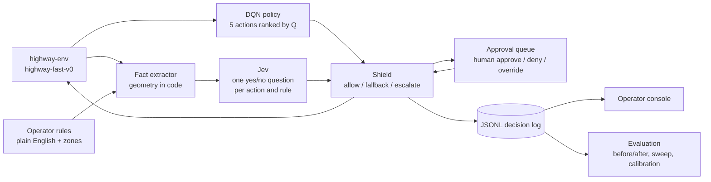

# Interlock

**The policy was trained once. The rules changed live, in plain English.**

Interlock is a runtime safety shield for a reinforcement learning agent, with a
human on the loop. A Stable-Baselines3 DQN drives in
[highway-env](https://highway-env.farama.org/) on task reward alone and knows
nothing about rules. At every simulation step, [Jev](https://docs.typesafe.ai),
TypeSafe's decision model, judges each of the agent's candidate actions against
operator rules typed in plain English and returns a probability of violation.
Code then allows the action, falls back to the agent's next-best safe action, or
pauses and asks a person. An operator console shows the road, the rules, the
approval queue, a decision inspector and the evaluation numbers.

## Pick your track

-   :material-steering: **User guide**

    ---

    For anyone who installs and runs Interlock: operating the console,
    adding rules, answering escalations, reading the inspector, running the
    command line and the evaluation, and deploying a live demo.

    [:octicons-arrow-right-24: Start with the concepts](user-guide/concepts.md)

-   :material-code-braces: **Developer guide**

    ---

    For anyone changing the code: the architecture, the per-step loop, the
    shield algorithm, facts, the Jev client, the server, the React console,
    the contracts between them, the tests, and how to extend each part.

    [:octicons-arrow-right-24: Read the architecture](developer-guide/architecture.md)

-   :material-book-open-variant: **Reference**

    ---

    Every environment variable, flag and constant in one place, a module by
    module API listing, and a glossary of the terms used across the project.

    [:octicons-arrow-right-24: Open the configuration reference](reference/configuration.md)

## What Interlock demonstrates

- **A reward-only policy made safe at runtime, with no retraining.** The DQN
  only ever sees [environment reward](developer-guide/backend/training.md#the-reward-function):
  speed, no collisions and a small right-lane bonus. Rules such as "Speed limit 25 m/s" or "Lane 3 is closed
  ahead for a work zone" are added while it drives.
- **A system that knows when to ask a person.** Jev's probability drives three
  outcomes. Confident safe runs, confident violation falls back, and the
  uncertain band escalates to an approval queue with the facts, the rule and
  the probability.
- **Honest numbers.** Violations, task return, crashes, escalation rate,
  latency, cost and calibration, measured over seeded episodes with the shield
  off and on, plus a threshold sweep that shows the tradeoff.

## How it works

Each step, the policy ranks its five actions, code turns the simulator state
into structured facts per candidate and drops any candidate under the
time-to-collision floor, Jev answers one question per (action, rule) pair,
and two thresholds split the result into allow, fallback or escalate. One JSONL record per step holds everything that happened, and the
console, the replay and the evaluation all read that one record format. The
[architecture page](developer-guide/architecture.md) walks through it in detail.

## Results at a glance

Twenty seeded episodes of 60 steps with seven standing rules, live Jev, and a
simulated operator that answers from the ground-truth checkers, measured on
Oct 17.

| Configuration | Violations per episode | Task return | Crash rate | Steps escalated |
| --- | --- | --- | --- | --- |
| Shield off | 105.45 | 50.7 | 40% | 0% |
| Shield on, thresholds 0.2 / 0.8 | 3.45 | 45.7 | 0% | 48.2% |
| Shield on, thresholds 0.3 / 0.7 (default) | 3.55 | 46.0 | 0% | 16.5% |

Put the same questions to chat models and Claude Sonnet 5.5 is better
calibrated than Jev on a balanced sample, yet at the default band it would
have allowed 3 violations and blocked 5 compliant actions where Jev allowed
and blocked none, at about a second per check against 158 ms per step.

The [evaluation page](user-guide/evaluation.md) has the full sweep, the per-rule
breakdown, the calibration numbers, the chat-model baseline and the reading of
them.

## Where things live

| What | Where |
| --- | --- |
| Source | [github.com/sequenzia/interlock](https://github.com/sequenzia/interlock) |
| Live console | [interlock-demo.vercel.app](https://interlock-demo.vercel.app) |
| Live backend | [interlock-backend.fly.dev](https://interlock-backend.fly.dev) |
| Backend | `backend/`, Python 3.12 via uv |
| Console | `frontend/`, Vite, React, TypeScript |
| Tests | `tests/`, pytest, plus a Playwright smoke test in `frontend/e2e/` |
| Planning history and the evaluation report | `internal/` |

!!! note "Naming"
    Interlock is an independent personal project and is not affiliated with
    any company. The name is the safety-engineering term for a mechanism that
    permits an action only when a condition holds, with a supervised override.
    In these pages, "the shield" is the lowercase technical term for the
    mechanism that allows, falls back or escalates.
