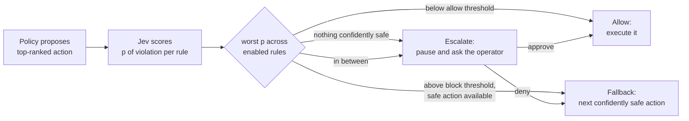

# Concepts

This page explains the ideas behind Interlock before you run anything. It is written for someone who knows roughly what reinforcement learning is but has not met a runtime shield or a decision model.

## The policy proposes, the shield disposes

A reinforcement learning policy is trained to maximize a reward. In Interlock the policy is a Stable-Baselines3 DQN driving in highway-env. Its reward pays up to 0.4 for speed between 20 and 30 m/s, 0.1 for keeping right and -1 for a collision, normalized so an ordinary step scores between 0.667 and 1.0; [the reward function](../developer-guide/backend/training.md#the-reward-function) spells it out. Nothing in that reward mentions a speed limit, a following distance or a closed lane. The policy has never seen a rule and it never will: it is trained once and never retrained.

A **shield** is a runtime monitor that sits between the policy and the simulator. Every step the policy proposes an action, the shield judges it, and only an approved action executes. If the proposal is unsafe the shield substitutes a safer one. This is the "shielding" idea from safe reinforcement learning. Interlock adds a third outcome: when the shield is unsure, it stops and asks a person.

## Rules in plain English

The rules the shield enforces are typed by an operator while the agent drives, for example "Speed limit 25 m/s" or "Lane 3 is closed ahead for a work zone". They can be added, disabled and removed mid-episode. Because the rules are text, something has to read them and decide whether a candidate action breaks them. That something is Jev.

## What a decision model is, as used here

Jev is TypeSafe's decision model. The way Interlock uses it is narrow and worth stating precisely:

- The input is a block of structured state plus a set of typed questions.
- Each question here is a yes/no assertion: "Executing the candidate action described in state would violate this operator rule: `<rule text>`".
- The output per question is a single probability between 0 and 1. There is no generated text to parse and no way for the model to invent a category.

The probability is treated as p(violation). One question is asked per (candidate action, enabled rule) pair, so the console can always say which rule fired.

## Three outcomes, two thresholds

For the policy's top-ranked action the shield takes the highest p across the enabled rules and applies two thresholds, by default 0.2 and 0.8:

| Worst p | Outcome | What executes |
| --- | --- | --- |
| below 0.2 | allow | the proposed action |
| above 0.8, with a lower-ranked action below 0.2 | fallback | the first such action in the policy's own ranking |
| 0.2 to 0.8 inclusive, with such an action available | escalate, uncertain | the simulation pauses; approve runs the proposal, deny runs the fallback, override runs the candidate the operator names |
| any value, with no action below 0.2 | escalate, no compliant action | the simulation pauses and the queue lists every candidate; deny runs the least-bad one, or SLOWER as a last resort flagged "all blocked" |

All five actions are judged in the same step, so falling back costs no extra round trip. The thresholds are live controls in the console and the evaluation sweeps them to show the tradeoff between violations and how often a person is asked. See [Shield algorithm](../developer-guide/backend/shield.md) for the exact rules.

## Three layers: physics in code, rules in the model, judgment to the human

Not everything belongs to the judge. A candidate that would close on the
vehicle ahead in under two seconds is removed in code before any rule is
consulted. That is the physics floor: it is arithmetic on a fact the
extractor already computes, it never asks a model anything, and an operator
cannot type it away. Rules in plain English are the model's layer, and the
calls the judge is unsure about are the human's. The floor applies only with
the shield on, so the shield-off baseline stays the raw agent.

## Why calibration matters

A threshold at 0.8 is only meaningful if 0.8 means "wrong about one time in five". If the model said 0.8 for things that were violations half the time, the allow and block bands would be mislabeled and the escalation band would be in the wrong place. Interlock therefore measures calibration: it compares Jev's probabilities against ground truth over tens of thousands of labeled checks and draws a reliability diagram. The numbers are in [Evaluation and results](evaluation.md).

## Human on the loop, not in the loop

A human *in* the loop approves every action. That does not scale and it makes the human the bottleneck. A human *on* the loop is asked only when the system knows it is unsure, and otherwise supervises. Interlock's approval queue is the on-the-loop design: confident calls run on their own, the uncertain band pauses the simulation and shows the operator the proposed action, the facts, the rule and the probability. Every answer is logged as a labeled example.

## Geometry stays in code

Jev's documentation lists arithmetic, counting, numeric comparison, multi-hop reasoning and a literal reading of negation as weaknesses. Interlock is designed around that:

- Code computes every number: the ego's lane and speed, the lane after the action, gaps and closing speeds to neighbours, whether a slower vehicle is ahead, whether the action enters a closed zone.
- Jev receives those numbers as JSON with units in the field names and judges the rule against them. It never measures anything.
- Each question is one judgment about one rule, phrased as a positive assertion with the rule text quoted verbatim.
- Rules typed with negation ("No lane change if ...") score softer than a positive phrasing. The console suggests a rephrase for such rules and keeps whatever the operator typed.

The fact schema is on the [Facts](../developer-guide/backend/facts.md) page.

## Ground-truth checkers score, never decide

Six of the eight preset rules have a small checker in code that labels a candidate action as a violation or not, for example "target speed after the action exceeds the limit". Those labels are what the evaluation counts and what the calibration compares against. They are never consulted by the shield: the decision comes from Jev's probabilities alone. If the checkers fed the decision the demo would be a rules engine, not a shield over a decision model. The other two presets, and any rule typed in free text, have no checker; the shield enforces them, nothing in code scores them, and only hand labels collected with `interlock label` bring them into the calibration.

## Mock mode and the cache

Every answer Jev gives is cached by a content hash of the state and the question. The cache is a JSONL file under `backend/logs/`. Two consequences:

- **Live mode** asks Jev only for questions it has not seen. A warm cache makes repeated runs on the same seed fast and free.
- **Mock mode** never calls the network. It serves the cache, and for anything it has not seen it returns p = 0.5 flagged "judge unavailable". At 0.5 the shield escalates, so the operator answers the question themselves. The shield never fabricates a judgment.

The same rule applies when live mode loses the network: escalate at 0.5 with the flag, never guess.

## Where to go next

- [Install](install.md) and the [Quickstart](quickstart.md) to run it.
- [The console tour](console/tour.md) for the operator's view.
- [Architecture](../developer-guide/architecture.md) for how the pieces fit.
