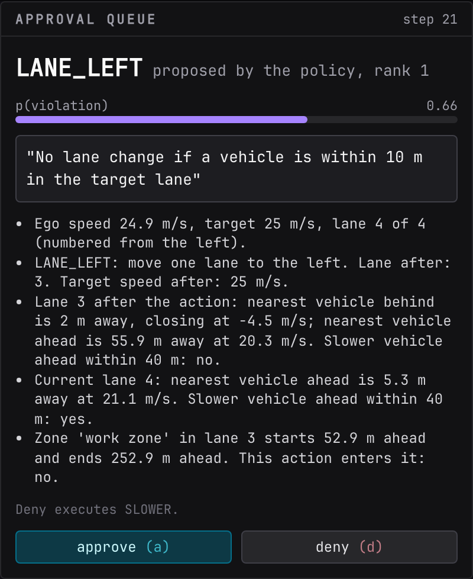

# Approval queue

The approval queue is the human-on-the-loop half of Interlock. It is empty almost all the time. When the shield is unsure, it fills with one card and the simulation waits.

## When an escalation happens

The shield escalates when the top-ranked action's worst p(violation) lands inside the band between the two thresholds, 0.2 to 0.8 by default. The loop pauses before the action executes, the status strip shows "waiting on operator", and the card appears with a violet border.

Two situations produce most escalations:

- A rule that is genuinely fuzzy for the judge. "Keep the left lane for passing only" sits near 0.5 for many lane-left moves.
- No answer at all. In mock mode with a cold cache, or in live mode when the network is down, every unanswered question is p = 0.5, which is inside the band by design.

## What the card shows

| Element | Meaning |
| --- | --- |
| Action name | the policy's proposed action, always its rank 1 choice |
| p(violation) bar | the worst probability across enabled rules for that action |
| Rule in quotes | the rule that produced that probability |
| "judge unavailable, p is a placeholder" | at least one question in this step had no answer; the 0.5 is not a judgment |
| Facts as sentences | the same facts Jev saw, rendered in plain words: ego speed and lane, what the action does, gaps in the target lane, the current lane, the lane to the right when relevant, zones |
| "Deny executes X" | the fallback the shield would run instead |
| "Auto-deny in N s" | the countdown, only when a timeout is configured |
| "approve" and "deny" | the two answers |

## Approve or deny

- **Approve** (++a++) executes the proposed action.
- **Deny** (++d++) executes the fallback named on the card: the next action in the policy's ranking that is confidently safe, or SLOWER (or IDLE) as a last resort, in which case the step is recorded as all blocked.

There is no third option. The operator cannot pick an arbitrary action, only accept or refuse the policy's proposal. Any connected console can answer; the first answer wins and the card disappears everywhere.

## The timeout

`ESCALATION_TIMEOUT_S`, or `--escalation-timeout` on `interlock console`, sets how long the server waits. The default is 20 seconds, after which the escalation is denied automatically. A value of 0 waits forever. The hosted demo runs with 0 so a missed card never silently slows the car.

!!! warning "Unattended default-deny can crash the car"
    Deny means the fallback, and the fallback is a different action from the one the policy chose for a reason. If the proposal was a lane change away from a slow vehicle, a run of auto-denies can put the car into it. Use a timeout of 0 whenever a person is actually watching.

## Judge unavailable

The badge "judge unavailable, p is a placeholder" means the shield has no opinion and is asking you to supply one. Read the facts and the rule, then answer as the judge would have. The record keeps `source: "unavailable"` on the judge, so these steps stand out in the log and the inspector.

## When the queue is idle

With no open escalation the panel title shows the running count, for example "3 approved · 1 denied", or "empty". The body says "Nothing waiting. The shield is deciding on its own." With the shield off it says "Shield is off. Nothing escalates."

## Where the answer goes

Each answer is written into the step's log record as `human`: the decision, how long the operator took in milliseconds, and `operator: "ui"`. The inspector shows it as a badge ("operator deny in 2140 ms"), the decisions strip tooltip appends it in parentheses, and the metrics message counts it. These records are the labeled examples that a later threshold tuning would use. See [Timeline and inspector](timeline-and-inspector.md) and the [Log record](../../developer-guide/contracts/log-record.md).

## On the command line

Headless runs have no queue. `interlock run --operator simulated` answers from the ground-truth checkers, `--operator approve` and `--operator deny` always give that answer. See [Command line](../cli.md).
