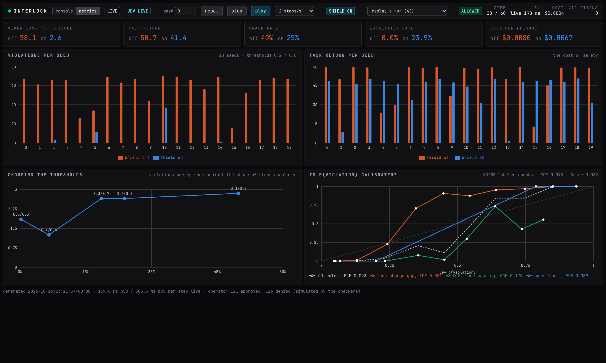

# Metrics tab

The "metrics" switch in the status strip replaces the console with the evaluation report: the measured effect of the shield over seeded episodes. The numbers are not from the episode you are watching. They come from `interlock eval`, see [Evaluation and results](../evaluation.md).



## What it loads

The tab fetches `/eval/latest` from the backend once when opened. The server returns the newest report written by the evaluation, `internal/eval/latest.json`. If none exists the tab says "No evaluation yet" and names the command that produces one:

```bash
uv run interlock eval --seeds 0-19 --all
```

The backend container ships with the report baked in, so the hosted console always has one.

## The five tiles

Each tile shows the shield-off value in orange and the shield-on value in blue, both at the default thresholds.

| Tile | Meaning |
| --- | --- |
| violations per episode | executed actions the ground-truth checkers labeled as violations, averaged over seeds |
| task return | the environment's own reward summed per episode, averaged: the cost of safety |
| crash rate | share of episodes that ended in a collision |
| escalation rate | share of steps sent to the operator (always 0 with the shield off) |
| cost per episode | Jev input tokens priced per episode |

## The four charts

**Violations per seed.** Grouped bars, one pair per seed, shield off versus on. The spread shows that the reduction holds on every seed and not only on average.

**Task return per seed.** The same layout for return. Expect the shielded bars to be a little lower: the speed limit costs speed reward.

**Choosing the thresholds.** One point per threshold pair in the sweep, plotted as violations per episode against the share of steps escalated, labeled `t_allow/t_block`. Moving left along the curve asks the operator less; moving down violates less. The knee is where to operate when operator attention is the scarce resource.

**Is p(violation) calibrated?** A reliability diagram. Jev's probabilities are bucketed into ten bins; for each bin the chart plots the mean predicted probability against the observed violation rate from the checkers. The grey diagonal is perfect calibration. One dashed line for all rules together and one solid line per preset rule. The legend carries each line's expected calibration error.

## Reading a reliability diagram

- A point on the diagonal means that when Jev said 0.7, about 70% of those checks really were violations.
- Points below the diagonal are overconfident: Jev said 0.7 and fewer were violations.
- Points above are underconfident.
- **ECE**, expected calibration error, is the average gap between the line and the diagonal weighted by how many checks fall in each bin. Lower is better; 0 is perfect.
- **Brier** in the subtitle is the mean squared error of the probabilities against the labels. It rewards both calibration and sharpness.

A rule with a flat or wobbly line between 0.3 and 0.6 is one the judge finds fuzzy; those are the probabilities that land in the escalation band.

## The footer

The last line gives when the report was generated, the p50 and p95 Jev latency per shielded step over live requests, and how many escalations the simulated operator approved and denied during the eval. The simulated operator answers from the checkers, so it is always right; a person will not be.

## Back to the console

Press "console" in the strip. The live episode kept running while you were on the metrics tab.
