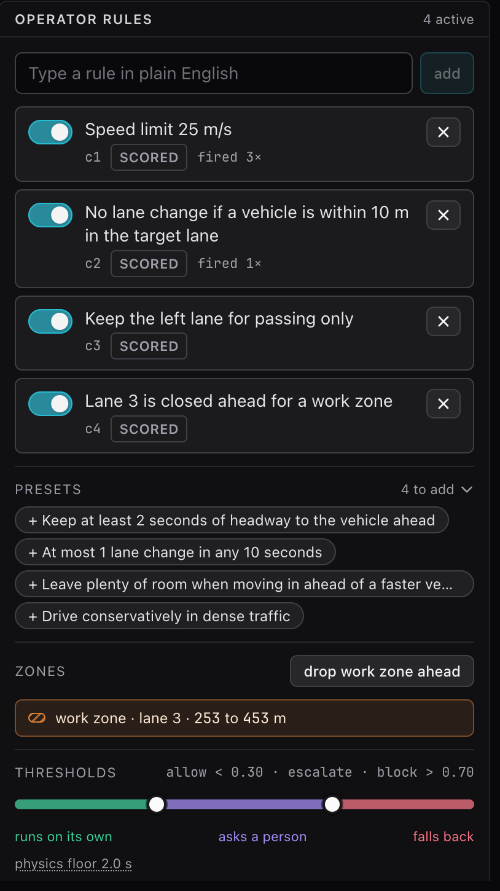

# Rules and zones

The operator rules panel is where the plain-English part of Interlock lives. Everything here can change mid-episode and takes effect on the next step.

## Typing a rule

Type a sentence in the box and press "add" or ++enter++. The text is sent to Jev verbatim inside every question from then on. Whitespace is collapsed, nothing else is changed.

Each rule gets an id (`c1`, `c2`, ...) that is stable for the session. The line under the text carries the id, a `scored` tag (hover it for the checker's name) or `not scored` when no checker exists, and `fired N×` once the rule has decided the outcome of a step.

## The eight presets

The chips under the rule list add one of the eight built-in rules. A chip disappears once a rule with that text is in the list, and the "Presets" heading collapses the row. Six presets carry a checker that scores them; the last two are fuzzy on purpose, Jev alone enforces them, and they are scored by hand labels (see [Evaluation](../evaluation.md)).

| Rule text | Checker id | What the checker labels as a violation |
| --- | --- | --- |
| Speed limit 25 m/s | `speed_limit` | the target speed after the action exceeds the limit |
| No lane change if a vehicle is within 10 m in the target lane | `lane_change_gap` | the action is a real lane change and the nearest vehicle ahead or behind in the target lane is closer than the threshold |
| Keep the left lane for passing only | `left_lane_passing` | the lane after the action is the leftmost lane and there is no slower vehicle within 40 m ahead in the lane to its right |
| Lane 3 is closed ahead for a work zone | `lane_closed` | the action enters a zone |
| Keep at least 2 seconds of headway to the vehicle ahead | `headway` | the headway after the action, gap ahead over the target speed, is below the number of seconds in the text |
| At most 1 lane change in any 10 seconds | `lane_change_rate` | the action is a real lane change and the lane changes in the last ten steps already reach the allowed count |
| Leave plenty of room when moving in ahead of a faster vehicle | none | not scored by code; labeled by hand |
| Drive conservatively in dense traffic | none | not scored by code; labeled by hand |

The lane-closed preset is normally added by dropping a zone rather than by its chip, see below.

## Checkers for typed variants

A rule you type is matched against a few text patterns to pick a checker, so variants of the presets stay scored:

| Typed text looks like | Checker |
| --- | --- |
| `speed limit <number>` | `speed_limit`, with the number as the limit (for example "Speed limit 20 m/s") |
| `at least <number> s of headway` | `headway`, with the number as the minimum (for example "Keep at least 3 seconds of headway") |
| `at most <number> lane change` | `lane_change_rate`, with the number as the allowed count in ten steps |
| contains `lane change` and `within <number> m` | `lane_change_gap`, with that distance |
| contains `passing only` | `left_lane_passing` |
| `lane <N> is closed` | `lane_closed` |

Anything else is a **free-text rule**. The shield enforces it exactly like the others, because Jev reads the text. It simply has no ground truth, so its checks are excluded from the violations counter and from calibration, and the inspector shows no mark next to its probabilities. Free-text rules are the point of a decision model: try "Overtake only on the left" and watch the probabilities.

## Enable, disable, remove

The switch disables a rule without removing it. Disabled rules are not asked about and do not count. The "×" removes the rule. Both are immediate and both are broadcast to every connected console.

## The rephrase hint

Jev reads literally and scores negated rules softer than positive ones. When the text you are typing starts with "No " and mentions a lane change, a hint offers the positive form of the gap rule: "A lane change requires at least 10 m of clear space to the nearest vehicle in the target lane". Press the chip to use it, or ignore it. The hint never changes what you typed.

## Zones

"drop work zone ahead" places a closed stretch of lane 3 starting 120 m ahead of the ego and 200 m long, in absolute road coordinates. Two things happen at once:

1. The zone appears in the list (`work zone · lane 3 · 420 to 620 m`) and as an orange hatch in the road view.
2. The rule "Lane 3 is closed ahead for a work zone" is added with the `lane_closed` checker, or re-enabled if it already exists.

From then on every candidate's facts carry the zone: how far ahead it starts and ends, and whether that action would put the ego inside it on the next step.

!!! note "Zones and their rule share a lifecycle"
    Jev gives weight to a rule that asserts a closure even when no zone is in the facts. So once the ego has passed the last zone the rule is disabled automatically and the panel shows "Zone passed. The lane-closed rule was retired." Press "ok" to clear the note. Dropping another zone re-arms the rule.

You can press the button more than once to queue several zones. Only zones ahead of the ego are in the facts; passed ones are dropped at the start of each step.

## Thresholds

One band at the bottom sets both thresholds: green up to the allow threshold ("runs on its own"), violet between the two ("asks a person"), rose above the block threshold ("falls back"). Drag the two handles in steps of 0.05; defaults 0.30 and 0.70, and the label above reads `allow < 0.30 · escalate · block > 0.70`. The allow handle cannot pass the block handle and vice versa. The value is sent when you release a handle and applies to the next step. While an escalation is open a white marker on the band shows where its probability landed.

Narrow the band (for example 0.4 and 0.6) and the shield asks less and decides more. Widen it (0.1 and 0.9) and nearly everything uncertain comes to you. The measured tradeoff is on [Evaluation and results](../evaluation.md).

## The physics floor

The line under the band states the physics floor, 2 seconds by default; hover it for the explanation. A candidate that would close on the vehicle ahead in under that time is removed before the rules are judged, so it never runs and never appears in the approval queue; the inspector fades such rows and tags them `floor`. There is no control for it on purpose: it is set when the backend starts (`interlock console --floor-s 0` turns it off) and no rule you type can override it.

## What persists

Rules, zones and thresholds belong to the session, not the episode. "reset" starts a new episode but keeps the rule list and any zone the ego had not yet passed. Zones are in absolute road coordinates, so a zone that was still ahead when you reset is ahead again on the new episode. A server restart clears everything.

In replay the whole panel is read-only and shows the rules as they were at each step of the logged run.

## On the command line

`interlock run` takes `--rules` with a comma list of checker ids, `all` for the three standing rules, or `none`, and `--zone-at-step N` to drop the default zone mid-episode. See [Command line](../cli.md).
