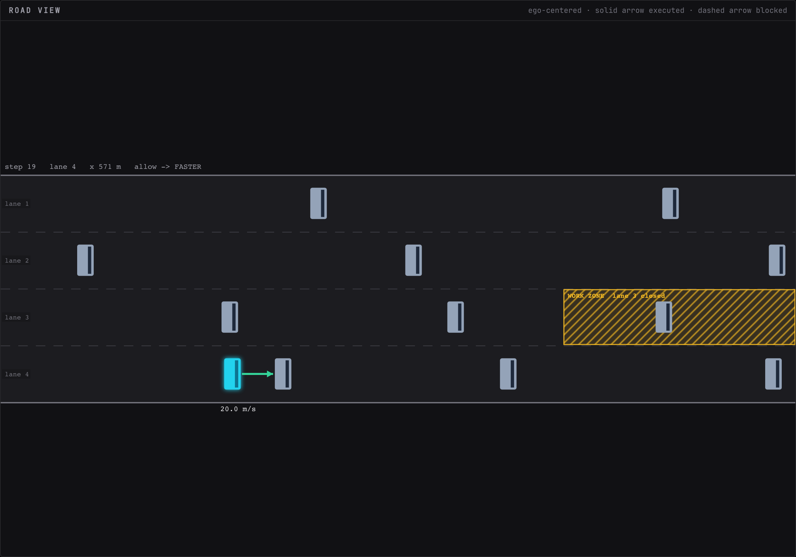

# Running an episode

An episode is one drive of up to 60 steps on one seed. It ends early if the ego crashes.

## Seed and reset

The seed in the status strip sets the traffic. Type a number and press "reset" to start a new episode on it. Reset discards the current episode, opens a new log file under `backend/logs/runs/`, cancels any open escalation, and keeps the rule list. The same seed always produces the same opening scene, which is what makes a shield on versus off comparison fair.

## Step, play, speed

- "step" (++n++) advances exactly one step and returns control to you.
- "play" (++space++) advances continuously at the selected speed: 0.5, 1, 2 or 4 steps per second. "pause" stops after the current step.
- An open escalation pauses the loop until it is resolved, whatever the speed.

Speed is a playback rate. The simulator itself takes one decision per simulated second regardless.

## What one step does

1. The policy ranks all five actions by Q-value: LANE_LEFT, IDLE, LANE_RIGHT, FASTER, SLOWER.
2. Code turns the simulator state plus each candidate action into facts with units: ego speed and lane, the lane after the action, gaps and closing speeds in that lane, whether a slower vehicle is ahead, any zone ahead and whether the action enters it.
3. Jev is asked, for each candidate and each enabled rule, whether executing that action would violate the rule. Cached answers are reused.
4. The shield takes the top-ranked action's worst probability and allows, falls back or escalates (see [Concepts](../concepts.md)).
5. The chosen action executes in the simulator. The ground-truth checkers label every candidate for scoring.
6. One record is logged and streamed to every connected console.

The whole step is one message on the wire, which is why replay and the inspector show exactly what the operator saw.

## Shield on and off

The "shield on" badge toggles the shield for subsequent steps. You can flip it mid-episode. The usual demo is: run a seed with the shield off, press "reset", flip the shield on, run the same seed again.

!!! note "Shield off still judges"
    With the shield off the top action always executes, but facts, Jev and the checkers still run in shadow. Decisions are logged as allowed, the violations counter still counts, and the step still costs the same Jev tokens. Before and after numbers come from the same code path.

## Reading the road view

- Lanes are numbered from the left starting at 1, matching the facts and the rules. Lane labels sit at the left edge.
- The ego is cyan with a glow and its speed is printed under it.
- A **solid arrow** from the ego shows the action that executed, colored by the decision: green allowed, amber fallback, violet escalated, rose all blocked. Left and right arrows are lane changes, a long forward arrow is FASTER, a short forward arrow is IDLE, a backward arrow is SLOWER.
- A **dashed rose arrow** is a ghost of the policy's top action when something else executed. Seeing both at once is the shield intervening.
- A closed zone is a hatched amber stretch of one lane labeled with its name, for example `WORK ZONE lane 3 closed`. Zones are placed with the "drop work zone ahead" button, see [Rules and zones](rules-and-zones.md).
- `CRASH` in rose above the ego marks the step that ended the episode in a collision.
- The line above the road repeats the step, lane, longitudinal position in metres, the decision, the blocked action if any, and the executed action.

## The decision badge

The badge at the right of the status strip is the latest step's outcome. `fallback -> IDLE` means the top action was confidently a violation and IDLE was the first lower-ranked action that was confidently safe. `escalated -> SLOWER` means the operator denied and the fallback ran. `allowed` with no arrow means the policy's own choice ran.

## All blocked

When the top action is a confident violation and no lower-ranked action is confidently safe, the shield executes SLOWER as a last resort, or IDLE if SLOWER itself scores above the block threshold. The step is shown as "all blocked" in rose. A deny on an escalation can land in the same place. It is rare at the default thresholds and common at very wide ones such as 0.1 and 0.9.

!!! warning "The shield enforces rules, not collision safety"
    The policy's own crash avoidance is what keeps the car out of accidents. A deny or an all-blocked step can override a lane change the policy wanted for exactly that reason. This is why the hosted demo runs with no escalation timeout and why a following-distance rule is a sensible addition to the rule set.

## When the episode ends

After step 60, or on a crash, the strip shows "episode over" and "step" and "play" grey out. Press "reset" for another episode, or pick the finished run in the replay picker to walk through it again.
