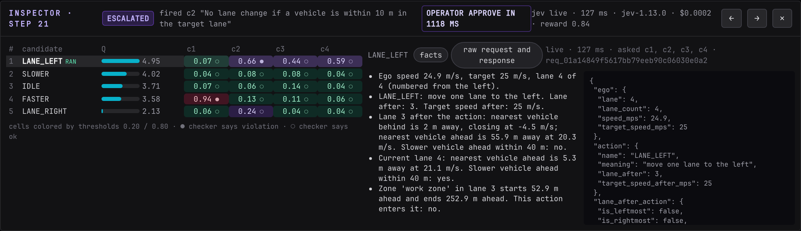

# Timeline and inspector

The decisions strip and the inspector drawer let you look at any step after the fact, including while the simulation keeps running.

## The decisions strip

The strip at the bottom of the left column has one tick per step, 60 for a full episode. Ticks fill in as the episode runs; the rest stay dim.

| Color | Outcome |
| --- | --- |
| green | allowed |
| amber | fallback |
| violet | escalated |
| rose | all blocked |

An escalated step is drawn at full opacity, the others slightly dimmer. Hover a tick for a tooltip such as `step 12: escalate -> SLOWER (deny)` or `step 31: escalate -> FASTER (override FASTER)`. Click a tick to select it: it grows taller with a white ring, the road view jumps to that step, the strip shows "inspecting 12", and the inspector opens. Click the same tick again or press ++esc++ to deselect and follow live.

## Scrubbing

++arrow-left++ and ++arrow-right++ move the selection one step at a time. From live, ++arrow-left++ selects the latest step. ++arrow-right++ past the last step returns to live. The inspector header also has "←", "→" and "✕".

While a step is selected the road view shows that step's vehicles and zones without animating, and its subtitle reads "arrow keys move · esc follows live". The simulation is not paused by inspecting; new steps keep arriving and the strip keeps filling.

## The inspector header

| Item | Meaning |
| --- | --- |
| "Inspector · step N" | the selected step |
| Decision badge | the outcome, with `-> ACTION` when the executed action differs from the proposal |
| `fired c2 "..."` | the rule with the highest probability on the proposed action, shown unless the step was allowed |
| "uncertain · deny runs IDLE (safe)" or "no compliant action · deny runs IDLE (least bad)" | why the step escalated and the fallback the shield had ready, with its kind: safe, least bad or last resort |
| "operator approve in 1840 ms" | the human answer and how long it took, for escalated steps; an override reads "operator override LANE_RIGHT in 2140 ms" |
| `jev live · 160 ms · jev-1.13.0 · $0.0002 · reward 0.83` | the judge source for the step, wall-clock latency for all five requests, model id, cost in dollars, task reward |

## The candidates table

Five rows, one per action, in the policy's ranking:

| Column | Meaning |
| --- | --- |
| # | rank by Q-value, 1 is the policy's choice |
| candidate | action name; `RAN` marks the executed action, `BLOCKED` marks a rank 1 action that did not run |
| Q | the Q-value with a bar scaled between the step's minimum and maximum |
| one column per enabled rule | p(violation) for that action against that rule |

Each probability cell is colored by the step's thresholds: green below the allow threshold, rose above the block threshold, violet in between. A small mark after the number is the ground-truth checker's label: ● the checker says violation, ○ the checker says ok, no mark for a rule without a checker. Hover a cell for the rule text, the probability and the label in words. Hover a column header for the rule text.

Reading the grid answers the usual questions. Why did the top action not run: its row has a rose cell. Why was IDLE chosen as fallback: it is the first row below the top whose worst cell is green. Was Jev right: compare the color with the mark.

Click a row to make that candidate the subject of the right-hand pane.

## The facts tab

The right pane shows the selected candidate. "facts" lists the sentences the operator would see in the approval queue, and next to them the JSON that was sent to Jev as state. They are generated from the same data; the JSON is the authority.

## The raw tab

"raw request and response" shows the exact exchange with Jev for that candidate: the request rebuilt from the model id, the candidate's facts as state, and the questions that were actually asked in that request; and the raw response with the per-question probabilities, usage and the request id. The line above the panes names the source, latency and the rule ids asked.

Three cases:

- `live · 131 ms · asked c1, c2 · req_...`: a request went out for those rules. Rules missing from "asked" were already cached.
- "no request sent: every answer came from the cache": nothing went over the network for this candidate.
- "no exchange in this log": an older record without exchange data.

A request to an unavailable judge appears with `unavailable` as the source and no response.

## In replay

Everything above works identically on a replayed run, because the inspector reads the log record and nothing else. See [Replay](replay.md). The field-by-field record is on the [Log record](../../developer-guide/contracts/log-record.md) page.
