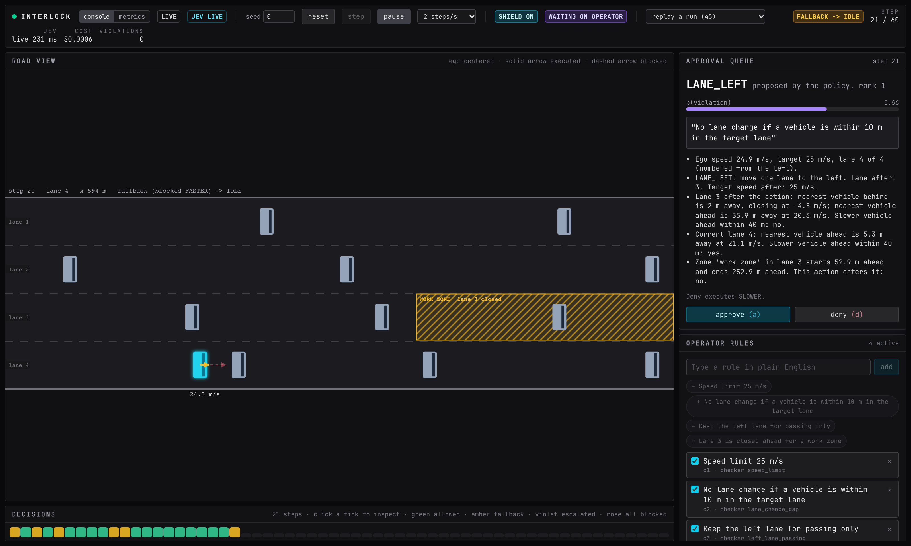
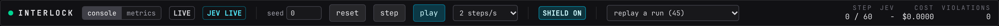

# Console tour

The console is a dark, dense operator view. It opens at <http://127.0.0.1:5173> when you run `uv run interlock console`, and it is the same page as the hosted console. Everything on it is driven by one WebSocket to the backend.

## Layout

| Region | Where | What it does |
| --- | --- | --- |
| Status strip | top | connection, mode, transport controls, shield toggle, replay picker, live stats |
| Road view | left, largest | ego-centered Canvas drawing of the road, vehicles, zones and the executed action |
| Inspector | left, under the road view | appears when a tick in the decisions strip is selected; see [Timeline and inspector](timeline-and-inspector.md) |
| Decisions | left, bottom | one tick per step, colored by outcome; click to inspect |
| Approval queue | right, top | the open escalation, or counts of answered ones; see [Approval queue](approval-queue.md) |
| Operator rules | right, below the queue | rules, presets, zones and thresholds; see [Rules and zones](rules-and-zones.md) |

The "console" and "metrics" switch in the strip swaps the whole area below the strip for the [Metrics tab](metrics-tab.md).

## Status strip

Left to right:

| Control | Meaning |
| --- | --- |
| Dot | green when the socket is open, red when it is reconnecting |
| INTERLOCK | the wordmark |
| console / metrics | which view fills the page |
| Source badge | `live` for the simulator, `replay` (amber) when a logged run is playing, `offline` before the first message |
| `jev live` / `jev mock` | the judge mode the server started with; cyan when live |
| seed and "reset" | type a seed and press "reset" to start a fresh episode on it; reset also ends any open escalation |
| "step" | advance one step; disabled while playing, while an escalation is open, and after the episode ends |
| "play" / "pause" | run at the chosen speed; disabled after the episode ends |
| Speed | 0.5, 1, 2 or 4 steps per second; default 2 |
| "shield on" / "shield off" | toggle the shield on the current seed; disabled in replay |
| "waiting on operator" | shown while an escalation is open |
| "episode over" | shown after the last step or a crash |
| Replay picker | lists logged runs, newest first; see [Replay](replay.md) |
| "back to live" | only in replay; returns to a fresh live episode on the same seed |
| "inspecting N" | shown while a tick is selected |
| Decision badge | the latest step's outcome, with `-> ACTION` when the executed action differs from the proposal |
| step | current step, over the episode length (60) or the replay length |
| jev | source and latency of the latest step's judging |
| cost | Jev cost so far this episode |
| violations | executed actions the ground-truth checkers labeled as violations so far |

## Road view

The road runs left to right with lane 1, the leftmost lane, at the top. The view is 240 m wide and the ego vehicle (cyan, with a glow) sits 70 m from the left edge, so about 170 m of road ahead is visible. Other vehicles are grey. Positions are interpolated between steps so playback is smooth at any speed. A closed zone is hatched in amber with its name and lane. Above the road a status line repeats the step, lane, position and decision. See [Running an episode](running-an-episode.md) for the arrows.

## Decisions strip

One tick per step, filled in as the episode runs. Colors are the outcome: green allowed, amber fallback, violet escalated, rose all blocked. Hover for a tooltip, click to select and open the inspector, click again to deselect. Details on [Timeline and inspector](timeline-and-inspector.md).

## Keyboard

Keys are ignored while the cursor is in a text box, a slider or a select.

| Key | Action |
| --- | --- |
| ++space++ | play or pause |
| ++n++ | one step |
| ++a++ | approve the open escalation |
| ++d++ | deny the open escalation |
| ++arrow-left++ | select the previous step (from live, the latest step) |
| ++arrow-right++ | select the next step; past the last step returns to live |
| ++esc++ | deselect and follow live |

## Errors

A command the server rejects, for example resolving an escalation that is no longer open or thresholds that do not satisfy allow at or below block, comes back as a rose toast in the bottom-right corner. The toast keeps the last five messages until you press "dismiss". A "not connected to the server" toast means a command was sent while the socket was closed; the client reconnects on its own with a backoff of up to five seconds.

## One session, every browser

The backend holds exactly one session. Every browser on the console URL sees the same episode, the same rules and the same escalation, and any of them can press play, reset or approve. A browser that connects or refreshes mid-episode receives the step history, so the timeline and the inspector survive a refresh. The client keeps at most the last 2000 steps.

If you share the hosted URL with a room, everyone in the room has the controls. That is a feature for a group demo and a surprise otherwise.
