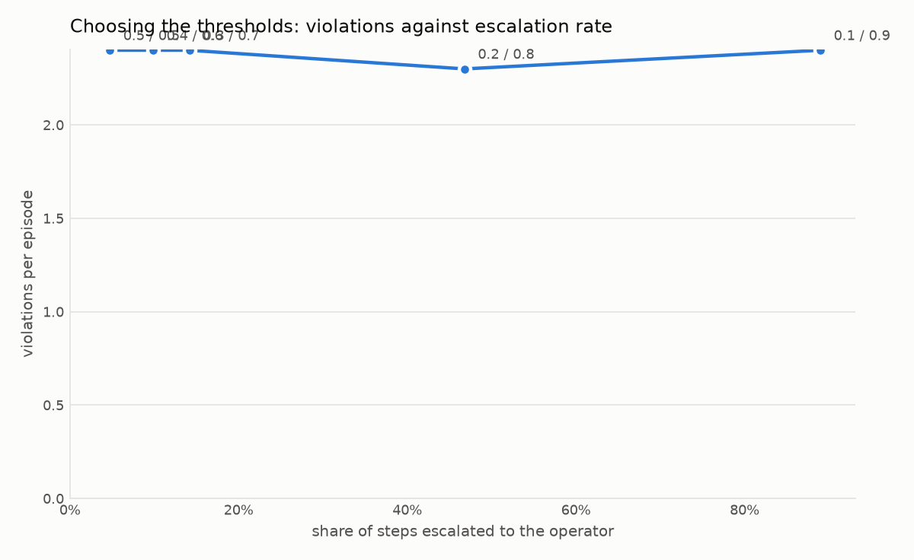

# Evaluation and results

The evaluation answers one question with numbers: what does the shield cost and what does it buy, over the same seeded episodes with the shield off and on. It also measures whether Jev's probabilities deserve to be thresholded.

## Running it

```bash
uv run interlock eval --seeds 0-19 --mode off                 # baseline
uv run interlock eval --seeds 0-19 --mode on                  # default thresholds 0.3 / 0.7
uv run interlock eval --seeds 0-19 --sweep                    # five threshold pairs, shield on
uv run interlock eval --seeds 0-19 --all --concurrency 2      # off, the sweep, then the report
uv run interlock eval --report                                # rebuild the report from the newest runs
```

Every configuration runs each seed as a 60-step episode with the seven standing rules: every preset except the lane-closed one, which only arrives with a zone. Since Oct 17 that is the speed limit, the lane change gap, the left lane for passing, the 2 second headway, one lane change per 10 seconds, and the two fuzzy presets about moving in ahead of a faster vehicle and driving conservatively in dense traffic. Escalations are answered by the **simulated operator**, which approves when the ground-truth checkers say the proposed action is fine and denies otherwise. Unknown labels are denied. When no candidate is confidently safe, it overrides with the candidate that breaks the fewest rules, ties going to the policy's ranking. Flags are listed on [Command line](cli.md).

The full `--all` run against live Jev takes about eight minutes at concurrency 2 and costs under a dollar.

### What it writes

| Path | Contents |
| --- | --- |
| `backend/logs/eval/<stamp>_<label>/seedN.jsonl` | one log per seed, same record as the console |
| `backend/logs/eval/<stamp>_<label>/metrics.json` | per-episode metrics, aggregates and calibration for that configuration |
| `internal/eval/latest.json` | the report: newest run per label, before/after, sweep, calibration |
| `internal/plots/before_after.png`, `tradeoff.png`, `calibration.png` | the three plots |

The label encodes the configuration, for example `on_ta0.30_tb0.70` or `off`; the shield-off label carries no thresholds because they change nothing when the shield is off. The report picks the newest folder per label, so rerunning one configuration replaces only that row. The before and after pair is the shield-on run at the default thresholds against the newest shield-off run. The console's [Metrics tab](console/metrics-tab.md) reads the same report. The file format is on the [Evaluation report](../developer-guide/contracts/eval-report.md) page.

### Hand labels for the fuzzy rules

The two fuzzy presets have no checker, so nothing in code can say whether Jev was right about them. `interlock label` fills that gap with your judgment:

```bash
uv run interlock label --run backend/logs/eval/<stamp>_on_ta0.30_tb0.70 --rule dense_traffic --sample 100
uv run interlock label --run backend/logs/eval/<stamp>_on_ta0.30_tb0.70 --rule cut_in --sample 100
uv run interlock eval --report
```

Each card shows a step's candidate action and the facts as sentences, with Jev's probability hidden, and takes `y`, `n`, `s` or `q`. The sampler spreads the cards across the range of Jev's probability so the reliability line gets points in every bin. Labels accumulate under `backend/logs/labels/`, keyed by the facts and the rule text, and `eval --report` folds them into the calibration with no Jev cost: the fuzzy rules then appear in the reliability diagram and the metrics tab marked "hand labels". A few hundred labels per rule is enough for a readable line. Flags are on [Command line](cli.md#interlock-label).

## Results

20 seeds, 60 steps, the seven standing rules, live Jev 1.13.0, simulated operator. Measured on Oct 17 with the conflict policy, the operator override, the wider fact schema and the lane-change count fact in place. This second Oct 17 sweep took about six minutes and cost $0.36: the count fact changed only the lane-change candidates' facts, so four of five candidates per step were already cached from the first sweep. The Oct 16 results with three rules are kept in the plan for comparison.

### Before and after

| Configuration | Violations per episode | Task return | Crash rate | Steps escalated |
| --- | --- | --- | --- | --- |
| Shield off | 105.45 | 50.7 | 40% | 0.0% |
| Shield on, 0.2 / 0.8 | 2.30 | 44.1 | 5% | 46.8% |
| Shield on, 0.3 / 0.7 (default) | 2.40 | 44.4 | 5% | 14.1% |


### By rule

Totals over the 20 episodes, shield off to shield on at the default thresholds, 0.3 / 0.7:

| Rule | Off | On |
| --- | --- | --- |
| Speed limit 25 m/s | 1030 | 0 |
| No lane change if a vehicle is within 10 m in the target lane | 124 | 1 |
| Keep the left lane for passing only | 8 | 0 |
| Keep at least 2 seconds of headway to the vehicle ahead | 647 | 43 |
| At most 1 lane change in any 10 seconds | 300 | 4 |

The two fuzzy presets have no checker and therefore no violation count. Their calibration arrives with hand labels; see above.

### The threshold sweep

| t_allow / t_block | Violations per episode | Return | Crash rate | Escalated | Conflicts | Overrides |
| --- | --- | --- | --- | --- | --- | --- |
| 0.1 / 0.9 | 2.40 | 44.4 | 5% | 89.0% | 62.5% | 614 |
| 0.2 / 0.8 | 2.30 | 44.1 | 5% | 46.8% | 4.4% | 41 |
| 0.3 / 0.7 (default) | 2.40 | 44.4 | 5% | 14.1% | 4.4% | 38 |
| 0.4 / 0.6 | 2.40 | 44.2 | 5% | 9.8% | 4.2% | 36 |
| 0.5 / 0.5 | 2.40 | 42.1 | 10% | 4.7% | 4.1% | 32 |

"Conflicts" is the share of steps escalated because no candidate was confidently safe, and "overrides" counts the simulated operator choosing a candidate other than the proposal on those steps. No step in any configuration ended in the SLOWER last resort.



### Calibration

Every candidate action is labeled against every scored rule on every step, and the report pools the records of every configuration, so the six runs of 20 episodes yield 169,500 labeled checks, 33,900 per rule.

| Rule | ECE | Accuracy at a 0.5 cut |
| --- | --- | --- |
| All rules | 0.095 | 98.7% |
| Speed limit | 0.056 | 100.0% |
| One lane change per 10 s | 0.083 | 100.0% |
| Lane change gap | 0.064 | 97.9% |
| Headway 2 s | 0.109 | 98.8% |
| Left lane for passing | 0.173 | 96.9% |

Brier score over all checks: 0.024. The two fuzzy presets appear here once they have hand labels.


### Latency and cost

| Measure | Value |
| --- | --- |
| Jev latency per shielded step, p50 | 133 ms (158 ms cold) |
| Jev latency per shielded step, p95 | 238 ms (293 ms cold) |
| Cost per episode, shield on | $0.0024 ($0.0051 cold) |
| Cost per episode, shield off | $0.0038 ($0.0132 cold) |

Shield-on figures are the default run. Four of five candidates per step came from the cache in this sweep; the cold figures in parentheses are from the first Oct 17 sweep, which ran with an empty cache. The shielded run is cheaper either way because it hits the cache more often: a shielded car visits fewer distinct states.

## How to read the numbers

- **Five of five scored rules are enforced.** The speed limit goes from 1030 violations to 0, the gap rule from 124 to 1, the lane-change rate from 300 to 4, and the headway rule from 647 to 43. Headway is the one that still leaks, because traffic can close a 2 second gap faster than one action can reopen it.
- **The passing-rule leak is gone.** On Oct 16 the shield turned 8 violations into 52 by looping on a no-op last resort in states where no action satisfied every rule. With the conflict policy those states escalate, the operator picks a way out, and the count is 0.
- **The crash rate fell from 40% to 5%.** The headway rule is a following-distance rule, which is exactly what the Oct 16 reading said was missing, and the least-bad fallback no longer slams the car into SLOWER when the policy wanted a lane change. The shield still enforces rules rather than collision safety; it is the rule set that changed.
- **The thresholds now trade operator load, not violations.** From 5% of steps escalated at 0.5 / 0.5 to 89% at 0.1 / 0.9 the violations stay between 2.30 and 2.40 per episode. Every uncertain or conflicting step reaches a decision maker at any pair; the pair only decides whether that is the judge alone or the operator. 0.5 / 0.5 has no band at all and twice the crash rate.
- **The default moved from 0.2 / 0.8 to 0.3 / 0.7.** Escalation at 0.2 / 0.8 doubled from the three-rule run, because seven rules put more steps inside the band and because conflicts escalate instead of running a silent last resort. The narrower band asks on 14.1% of steps instead of 46.8% for the same violations and crash rate, so it is the default since Oct 17. At 0.1 / 0.9 almost every step is a conflict, which is the simulated operator doing the driving.
- **One fact fixed the lane-change rate rule.** In the first Oct 17 sweep the facts gave the count so far and the judge had to add this action and compare, which is the counting its documentation warns about: p 0.2 to 0.3 was a violation 95% of the time and accuracy at a 0.5 cut was 94.0%. With `lane_changes_last_10_steps_including_this_action` on every real lane-change candidate the judge reads one number against the rule's. Now every check below 0.3 is a compliance, every check above 0.5 a violation, nothing lands between, and accuracy is 100%. It is still underconfident in size, p 0.6 to 0.9 where the observed rate is 1.0, which is what keeps that rule's ECE at 0.083 and nudged the pooled ECE up from 0.084 while the Brier score and accuracy improved. The same change moved the 0.5 / 0.5 point: it used to wave those second lane changes through at p 0.2 and now blocks them, so its rate violations fell from 9 to 4 and its headway violations rose from 21 to 42, because the car stays behind slow traffic. The headway rule shows the old shape more mildly.
- **The simulated operator is perfect.** It answers from the checkers, so the high-escalation settings are flattered, and its 614 overrides at 0.1 / 0.9 are not something a person would match.
- **Return drops by about six points.** Less than the nine of the three-rule run, because the override keeps the car moving where SLOWER used to stall it.

## Reproducing

The eval is deterministic in the simulator (seeded) but not in Jev, whose answers vary by a few hundredths between identical requests. Rerunning against the warm cache reproduces the numbers exactly; rerunning with a cleared cache reproduces them closely. Internals are on [Evaluation internals](../developer-guide/backend/evaluation.md).
